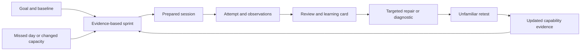
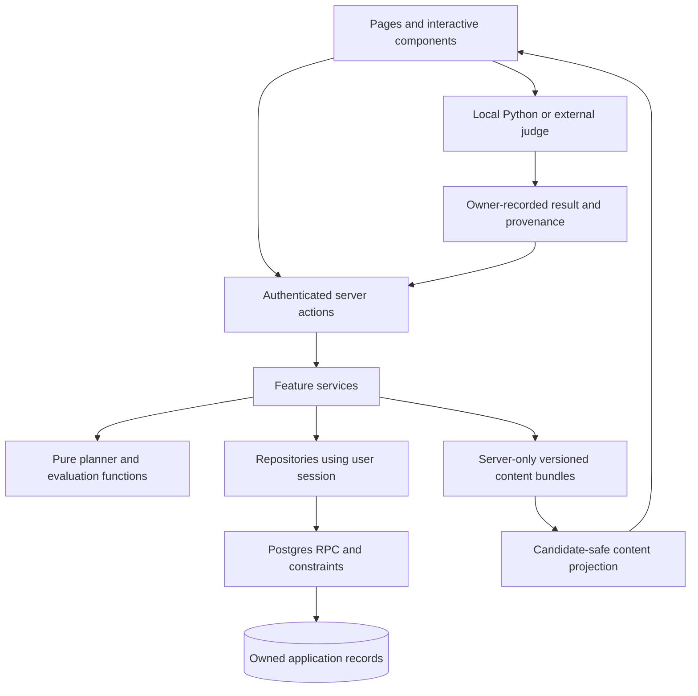
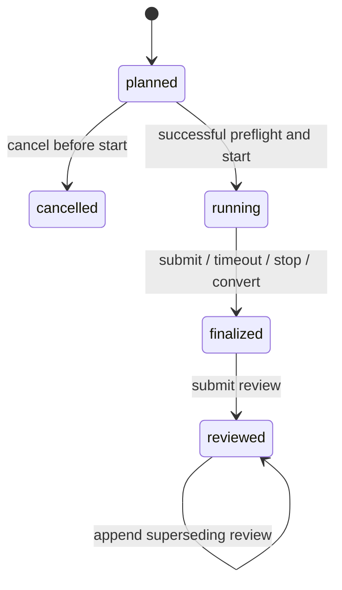

# Planly — Product and Engineering Build Specification

**Version:** 1.0 · **Prepared:** September 8, 2026 · **Release target:** personal release R1

**Purpose:** give a coding agent one self-contained document from which to implement, test and deliver Planly. Product requirements, stack choices, architecture, domain rules and release gates are fixed below. This document includes its curriculum appendix; the builder does not need earlier conversations or planning files.

**Current state:** requirements and design exist; the application has not been implemented. Service accounts, credentials and hosting have not been provisioned or verified. Decisions below are implementation decisions, not claims that procurement or deployment has occurred.

**Authority:** use this document as the implementation baseline. A subsequent explicit user instruction can revise it. Record material changes with a reason. Do not silently substitute a different stack, turn a required behaviour into a placeholder, or treat historical planning documents as competing requirements.

**Reading guide:** [purpose](#1-product-purpose-and-success) → [six backbone components](#2-the-six-backbone-components) → [fixed stack](#4-fixed-technology-decisions) → [architecture](#5-architecture-and-project-structure) → [session contracts](#9-session-lifecycle-and-durable-writes) → [planner](#11-deterministic-adaptive-planner) → [database](#12-database-and-domain-contracts) → [milestones](#16-implementation-milestones) → [acceptance checks](#17-acceptance-criteria-and-test-plan) → [coding-agent instructions](#18-coding-agent-execution-instructions). The full curriculum is in [Appendix A](#appendix-a-complete-source-curriculum).

## 1. Product purpose and success

Planly is a private interview-training platform that turns a goal and observed performance into feasible sprints, runs preparation sessions, preserves what happened, and chooses targeted practice that can demonstrate improvement.

The initial user is a CSE student in India, graduating December 2026, with CGPA 7.6 and Python as their strongest language. They want to compete for demanding product-company and big-tech SDE internships/new-graduate opportunities, including CRED. They need to rebuild independent coding, start DSA from foundations, prepare across hiring rounds, explain decisions clearly and sustain practice after missed days. Their current skill level is **unknown until assessed**.

The default preparation checkpoint is November 30, 2026. Dates, language, target roles and capacity are editable data. The application must work when installed after these dates. Do not hardcode calendar dates into planning logic or automatically mark historical work complete.

**The product's central loop:**



A useful outcome is that the user can answer: **What should I do next, why that task, what did my attempt reveal, and did the repair transfer?** A dashboard, problem counter or chat interface without this loop does not satisfy R1.

Hiring is an external outcome. Show evidence by competency and round, not an invented hireability percentage or company endorsement. A company name does not establish a universal interview sequence or eligibility rule. Store actual role invitations and source confidence.

## 2. The six backbone components

| Backbone | Responsibility | Invariant |
|---|---|---|
| B1. Curriculum and session content | Patterns, prerequisites, validated prompts, role packs, follow-up scripts and exposure | A catalogue title is not a prepared assessment; a familiar prompt is never labelled unseen |
| B2. Adaptive planner | Sprint outcomes, capacity, session selection, missed-day changes and review queues | Every assignment fits declared capacity and has a reason; history is preserved |
| B3. Interview Arena | Preflight, timer, drafts, question progression, clarification, follow-ups and submission | A strict attempt preserves its conditions and cannot be edited after finalization |
| B4. Evidence and remediation | Stage-specific review, mistakes, learning cards, repairs and transfer checks | Task completion alone never establishes competence |
| B5. Persistence and access | Owner authentication, transactional writes, concurrency, exports and recovery | Private records remain owned, consistent and recoverable |
| B6. Daily product experience | Today, sprints, Prep Hub, evidence, applications and weekly review | The primary screen makes the next useful action clear with minimal administration |

These boundaries are the architecture. Pages are views over them. Keep planning and evaluation rules out of React components.

## 3. Scope and requirement IDs

Every `R` requirement below is mandatory for the completed personal release. A milestone can implement a subset without claiming the whole product is finished.

| ID | Requirement | Observable completion |
|---|---|---|
| R01 | Private owner access and profile | One provisioned owner logs in; anonymous and other authenticated accounts cannot access private data |
| R02 | Goal, target-role configuration and baseline | Known profile is editable; baseline produces observed evidence and explicitly unknown dimensions |
| R03 | Adaptive two-week sprints | Outcomes, evidence inputs, feasible assignments, original commitment and revised plan are persisted |
| R04 | Today and recovery | One main action with reason; reduced/rest day and missed-day replanning produce feasible alternatives |
| R05 | Pattern-based Prep Hub and POTD | All 198 catalogue entries retained; filters, prerequisites, resources and relevant daily selection work |
| R06 | Prepared session packs | Every enabled stage has validated instructions, prompts, resources, duration, follow-ups and rubric |
| R07 | OA simulation | Multi-question navigation, saved code, server deadline, resource policy and finalization work |
| R08 | Technical interview practice | Clarification, reasoning, implementation, testing and relevant changed-constraint follow-ups are recorded |
| R09 | Engineering, project and behavioural preparation | Distinct packs collect actual artifacts/answers and use appropriate rubrics |
| R10 | Durable attempts and honest evidence | Final code, timing, exposure, help, observations and execution provenance survive reload |
| R11 | Submission learning and review | Review cites evidence; one useful lesson is saved; feedback can be uncertain or disputed |
| R12 | Repair and unfamiliar retest | Supported failure creates a specific drill/retest path; retest evidence determines the next action |
| R13 | Spaced recall | Bounded recall scheduling distinguishes conceptual retrieval from full-code retention |
| R14 | Readiness and weekly review | Round-specific evidence, missing data, denominators and the next bottleneck are visible |
| R15 | Applications and practical growth | Role/application notes, project ownership and optional daily habit notes support the training goal |
| R16 | Export and restore | Versioned user-data backup round-trips into an empty workspace without changing evidence meanings |
| R17 | Engineering quality | Ownership, concurrency, planner, content, browser and build checks pass with reproducible setup |
| R18 | Usable deployment and handoff | Local environment works; configured hosted environment passes smoke checks; limitations are documented |

**R1 interaction model:** scripted solo and peer-led practice. A peer speaks through an existing call/in person; the owner records the peer's observations and identifies their provenance. R1 does not create peer accounts, video calls or collaborative editing. AI interviewing/review is optional future work, not required to save, plan or study.

**Deferred:** public SaaS, subscriptions, teams, leaderboards, social feeds, native mobile apps, autonomous applications/outreach, live voice AI, microphone recording/upload, browser proctoring, arbitrary server code execution, automatic external-judge scraping, embeddings/vector databases, complex analytics infrastructure and senior-system-design courses unrelated to an actual target role.

The user can build with any coding agent. That choice must not create a runtime model dependency inside Planly.

## 4. Fixed technology decisions

| Concern | Decision | Reason |
|---|---|---|
| Architecture | Feature-oriented modular monolith, one deployable application | Clear boundaries with low operational overhead |
| Runtime/package manager | Node.js 24 LTS, npm, committed `package-lock.json` | Reproducible local and CI environment |
| Web framework | Next.js 16 App Router, React 19, TypeScript strict mode | Server-rendered authenticated pages with interactive Arena components |
| UI | Tailwind CSS 4, selected shadcn/ui primitives, Lucide icons | Consistent accessible components without a custom component framework |
| Coding workspace | CodeMirror 6, lazily loaded client-side; Python/text/SQL language modes | Editing, syntax highlighting and saved drafts; not code execution |
| Forms/validation | Native/React forms and Zod schemas; shared validation shapes | Explicit input contracts; server validation remains authoritative |
| Database/auth | Supabase PostgreSQL, Supabase Auth, RLS | Relational invariants, ownership and managed authentication |
| Database client | `@supabase/supabase-js` and `@supabase/ssr`; generated database types | One typed access path using the user's authenticated session |
| Compound mutations | Narrow PostgreSQL RPC functions invoked through feature services | Atomicity, idempotency and state guards |
| State | Server data from Server Components; local React state for active UI | Avoid a second global copy of persisted application state |
| Tests | Vitest for domain rules, PostgreSQL integration tests, Playwright for browser flows | Verify behaviour at the boundary that owns it |
| Hosting | Vercel for the app, Supabase for hosted database/auth | Straightforward deployment for this personal application |
| CI | GitHub Actions, npm scripts | Repeatable checks independent of the coding agent |
| Candidate runtime | Local Python 3 and/or external practice judge | Candidate code never executes in the Next.js server |

Install current compatible **patched releases within these chosen major lines**, verify peer dependencies/advisories, pin the resolved versions and record them in the README. Do not install prereleases, mix lockfiles or upgrade majors as an incidental refactor. Exact patches are resolved at implementation time; this document does not pretend an untested dependency set has been installed.

Next.js documents the version-16 routing/runtime changes and its App Router setup; Node lists 24 as LTS. Follow the selected versions' official conventions, including `proxy.ts` where applicable. [Next.js 16](https://nextjs.org/blog/next-16), [Node release status](https://nodejs.org/en/about/previous-releases)

Use Supabase SSR clients with validated identity at server boundaries; do not authorize from an unverified cookie/session object. PostgreSQL constraints and RLS remain required even when a page is hidden. [Supabase SSR](https://supabase.com/docs/guides/auth/server-side/creating-a-client?framework=nextjs&queryGroups=framework), [RLS](https://supabase.com/docs/guides/database/postgres/row-level-security)

Do not add Prisma, Drizzle, Clerk, Auth.js, Express/FastAPI, Redis, queues or microservices to R1. Add a dependency only for a concrete unmet requirement and document the reason. Hosting plan terms and limits must be checked during provisioning; no permanent free-tier guarantee is assumed.

## 5. Architecture and project structure



Create the app in `planly-app/` when working in the existing planning workspace. In a fresh repository, use the repository root. Preserve unrelated files and user changes. Relative paths below are relative to the **application root**.

```text
planly-app/
  README.md
  PLANLY_BUILD_SPEC.md                 # Copy of this exact baseline
  package.json
  package-lock.json
  tsconfig.json
  next.config.ts
  eslint.config.mjs
  postcss.config.mjs
  .env.example
  .gitignore
  .nvmrc
  .github/workflows/ci.yml
  docs/
    BUILD_STATUS.md                    # Requirement/milestone/check status
    DECISIONS.md                       # Consequential deviations and rationale
    RUNBOOK.md                         # Provision, deploy, diagnose, back up, restore
  src/
    app/
      layout.tsx
      globals.css
      page.tsx                        # Redirect based on auth/onboarding state
      (auth)/login/page.tsx
      (workspace)/layout.tsx
      (workspace)/onboarding/page.tsx
      (workspace)/today/page.tsx
      (workspace)/sprints/page.tsx
      (workspace)/arena/[sessionId]/page.tsx
      (workspace)/debrief/[sessionId]/page.tsx
      (workspace)/repairs/page.tsx
      (workspace)/prep/page.tsx
      (workspace)/prep/[problemId]/page.tsx
      (workspace)/evidence/page.tsx
      (workspace)/targets/page.tsx
      (workspace)/projects/page.tsx
      (workspace)/weekly/page.tsx
      (workspace)/settings/page.tsx
      api/backup/export/route.ts
    proxy.ts
    features/
      identity/
      planning/
      curriculum/
      sessions/
      reviews/
      repairs/
      progress/
      targets/
      projects/
      backup/
    components/ui/
    lib/
      supabase/client.ts
      supabase/server.ts
      supabase/database.types.ts
      auth/require-owner.ts
      time/
      validation/
      observability/
    server/content/                   # server-only imports and safe projections
  content/
    catalogue.json                    # 198 metadata entries from appendix
    patterns.json
    bundles/v1/                       # Prompts, scripts, rubrics, references
  supabase/
    config.toml
    migrations/
    seed.sql                          # Synthetic development state only
  scripts/
    validate-content.ts
    seed-dev.ts
    restore.ts                        # Local authenticated backup import command
  tests/
    unit/
    integration/
    e2e/
    fixtures/
  vitest.config.ts
  playwright.config.ts
```

Inside a feature, create `schemas.ts`, `rules.ts`, `service.ts`, `repository.ts`, `actions.ts` and `components/` **as needed**. Do not create empty layers for every function. Rules take data and return data; repositories own database access; actions authenticate, validate and call a service. Shared code must have more than one real consumer.

Use server actions for first-party mutations. Add an HTTP route only for a concrete need such as streaming backup export; do not duplicate each action as a REST endpoint. Private pages/results must not enter shared public caches. Never import server repositories or answer bundles into client components. No `SELECT *` over mixed candidate/private content.

## 6. User experience and principal journeys

### 6.1 Onboarding and baseline

Prefill CSE, December 2026 graduation, Python, general SDE/backend, CRED plus an editable big-tech target, `Asia/Kolkata`, and the November checkpoint. CGPA is an optional application field, not a scoring input. Ask for available minutes and uninterrupted windows for the next seven days; do not infer unlimited availability from motivation.

Offer a 20–25-minute Python/array diagnostic, a short talk-aloud response, one project inventory and a 90-second introduction prompt. Each can be completed separately. Preserve an unfinished diagnostic. Produce observations/unknowns, not a guessed percentile. Basic Python difficulty leads to a smaller warmup before advanced patterns.

### 6.2 Today

The primary card contains task title, session type/mode, estimated duration including debrief, reason, prerequisite/content availability and **Start**. Below it show at most two short supporting items, remaining capacity, save/backup status where relevant and a compact evidence summary. Example: “Your last two attempts missed boundary cases. Practise the boundary drill, then take a different test.” Link that reason to evidence.

Actions: start, choose a feasible alternative, change today's capacity, minimum day, rest day, and view proposed changes. The user need not repeatedly fill a detailed planner. A changed day triggers a computed preview; accepting/starting commits it once. No silent task deletion or surprise double workload.

### 6.3 Sprints and weekly review

A sprint normally spans 14 days; weekly budgets use Monday–Sunday in the user's timezone. Persist one main bottleneck, one supporting lane, one to three observable outcomes, prerequisite rules, benchmark conditions, committed assignments, repair/retest allocation, original commitment and change history. At exit each outcome is met, partial, untested or deferred, with evidence.

The weekly review asks what changed, which failure repeated, which repair transferred, what remains untested and what should be removed. Save one adjustment and next capacity. Scheduled dates never automatically pass a topic or sprint.

### 6.4 Arena and debrief

Preflight verifies available content, allowed resources, input/output format, timebox, exposure declaration, coding environment and evaluator mode. Show a harmless environment sample before starting the clock. A failed preflight gives a concrete recovery step.

During a coding session use a desktop split view: prompt/navigation, editor, tests/notes, and clarification/follow-up panel. Keep time and save status visible without constant warnings. On narrow screens use accessible tabs. Provide download/copy code and record-result actions; never label an editor button “Run” when execution is not implemented.

After finalization show the frozen attempt beside test evidence and the appropriate rubric. Fast save needs outcome, help used and one lesson; deeper observations fit inside the debrief. The user confirms/adjusts one repair or records insufficient evidence. Original failure and later corrected work remain separate.

### 6.5 Supporting pages

| Page | Required behaviour |
|---|---|
| Prep Hub | Search/filter the catalogue by family/tier/status; show concepts, prerequisites, verified resources and learning cards; distinguish metadata-only entries from prepared exercises |
| Repairs | Show trigger evidence, drill, retest availability and closure criterion; launch next action |
| Evidence | Separate OA, technical, engineering/project, behavioural and foundational capability; show samples, dates, assistance and evaluator provenance |
| Targets | Company/role/source/date/known stages/unknowns, application stage, resume version, deadline and next action; no automated sending |
| Projects | Problem solved, own contribution, repo/demo reference, architecture notes, actual bug and change evidence; no fabricated impact figures |
| Settings | Profile, timezone, capacity, preferences, export and restoration instructions |

Personal growth is lightweight: optional sleep opportunity, movement, focus/energy note, and next action. No guilt notifications or streak penalties. A weekly project explanation can include a 60-second value pitch: user problem, implemented change, observed result and next test. It occupies existing communication/project time.

### 6.6 Visual and accessibility direction

Use a calm workbench: neutral surfaces, one restrained accent colour, clear hierarchy, readable body text and monospace code. Prefer useful whitespace and compact evidence labels over oversized cards and charts. Main navigation: Today, Sprints, Arena/Repairs, Prep, Evidence, Targets, Settings; secondary pages can sit inside these groups.

Support light/dark system preference, keyboard navigation, visible focus, labelled fields, semantic headings and errors adjacent to their inputs. Status must not rely on colour alone. Respect reduced motion. Every page needs meaningful empty/loading/error/saved states. No fake activity, prefilled success graphs or decorative hiring scores. Prioritize desktop coding and usable mobile review; a native app is outside R1.

## 7. Training defaults and curriculum

### 7.1 Capacity and daily practice

Full mode proposes 1,080 assigned minutes weekly, requiring at least 1,350 available minutes under the 80% buffer rule. It is selectable after the baseline/ramp, not an assumption about current stamina.

| Lane | Assigned minutes/week |
|---|---:|
| DSA learning, variants and substantial repairs | 420 |
| OA 70-minute session plus 20-minute debrief | 90 |
| Live technical 45 plus 15 debrief | 60 |
| Project/CS defence 35 plus 10 debrief | 45 |
| Behavioural 20 plus 10 debrief | 30 |
| SQL/CS/Python fundamentals | 90 |
| Project building | 180 maximum |
| Applications/resume/referrals | 60 |
| Short recall | 75 maximum |
| Weekly review | 30 |
| **Total** | **1,080** |

All lanes share the same budget. Longer machine-coding or actual assessments replace other assignments. The generic OA format is a practice default, not a company claim. Full mode can be reduced; never force an 18-hour plan into less available time.

Start with 20–45-minute manageable sessions and lengthen gradually. A minimum day is 12 minutes: start 1, small coding/recall 5, SQL/CS explanation 3, save blocker/next step 3. Rest may be zero. These maintain continuity but do not count as full timed benchmark evidence.

One ordinary day has one main session, one saved lesson/evidence item and a brief recall/explanation. SQL normally has three focused weekly sessions. POTD selects a needed problem inside a committed learning/repair slot, rather than adding a compulsory extra question.

### 7.2 Default learning progression

| Stage | Focus | Parallel practice |
|---|---|---|
| Baseline/ramp | Python, arrays, dictionaries, loops, complexity | Small blank-editor attempt and talk-aloud |
| Foundation 1 | Arrays, hashing, prefix sums, sorting, two pointers | Clarification, brute-force vs improved approach, boundary tests |
| Foundation 2 | Binary search and answer feasibility | Short timed set and explicit invariant |
| Core 1 | Windows, lists, stacks, queues, heaps | Debugging and growing live-session length |
| Core 2 | Recursion/backtracking, trees, BST, LRU | Full live technical, changed constraints and project defence |
| Core 3 | Graph traversal, topology, weighted paths, DSU/MST, greedy | Mixed unfamiliar OA and algorithm-choice explanation |
| Core 4 | DP state/base/transition, grids, capacity, strings/sequences | Recurrence derivation, testing and mixed assessments |
| Consolidation | Weak families and unfamiliar transfer | Configurable full hiring loop spread across the week |

This is a prerequisite-aware template. Dates forecast scope; actual evidence controls progression. Tier A contains 82 primary problems, B 78 extensions, C 38 optional advanced entries. Preserve all 198 IDs/titles/groups and family mappings from Appendix A. Completion of all 198 is neither required nor sufficient to claim interview readiness.

Beginner prerequisites also need prepared exercises: list/dict/set operations, function arguments/returns, loops, sorting keys, input parsing, complexity, deque/heap use and small classes. Do not start with a medium DP task because its calendar week arrived.

### 7.3 Additional preparation

SQL: filters/NULL, aggregation/HAVING, joins/cardinality, subqueries/CTEs, CASE/dates, window functions, EXPLAIN/index basics. Seed at least one executable fixture and expected-result exercise per stage; learning uses local PostgreSQL or a user-selected external SQL environment, with reported results.

CS: DBMS keys/normalization/indexes/transactions/isolation; OS processes/threads/races/deadlocks/memory; networking DNS/TCP/HTTP/TLS/cookies/CORS; OOP encapsulation/composition/interfaces. Prepare six short prompts per subject, each with definition, applied example, tradeoff and failure case.

Development: reproduce a small React component, trace a request, implement validation/API/database behaviour, debug from reproduction to evidence to fix. Planly is the primary portfolio project. ML/DL is an optional maintenance lane if genuinely relevant to a target; it does not displace the core interview loop.

Behavioural: six truthful story outlines covering ownership, a difficult bug, learning, disagreement, mistake and constraint. College and personal projects count. Applications continue while preparing; readiness gates are not permission to apply.

## 8. Session packs, content and evidence boundaries

### 8.1 Versioned content contract

Content bundles are immutable files loaded only by server code. Validate them with Zod and a content validation command. Database records reference bundle version and SHA-256 content hash; historical sessions never silently load a changed prompt.

```typescript
type Stage = 'foundation' | 'oa' | 'technical_a' | 'technical_b'
  | 'engineering' | 'project' | 'behavioural';
type Mode = 'learn' | 'practice' | 'strict';
type EvaluatorMode = 'scripted_solo' | 'peer_led';
type ContentStatus = 'draft' | 'validated' | 'retired';

interface SessionPack {
  id: string; version: number; stage: Stage; status: ContentStatus;
  title: string; instructions: string;
  durationMinutes: number; debriefMinutes: number;
  inputFormat: 'function' | 'stdin_stdout' | 'repository' | 'spoken_or_text';
  resourcePolicy: { docs: boolean; ai: boolean; hints: boolean; notes: boolean };
  promptIds: string[]; rubricId: string; rubricVersion: number;
  prerequisites: string[]; source: SourceRecord;
}
interface TrainingPrompt {
  id: string; version: number; status: ContentStatus;
  familyIds: string[]; difficulty: 'foundation' | 'easy' | 'medium' | 'advanced';
  statement: string; constraints: string[];
  examples: { input: string; expected: string; explanation?: string }[];
  clarificationBranches: { id: string; question: string; answer: string }[];
  followups: { id: string; trigger: string; question: string; criterion: string }[];
  privateReference: { approach: string; checks: string[]; expectedComplexity?: string };
  repairLinks: { competency: string; drillId: string; retestIds: string[] }[];
  reservedForRetest: boolean; source: SourceRecord;
}
interface SourceRecord {
  kind: 'original' | 'official' | 'candidate_report' | 'custom';
  url?: string; checkedAt?: string; eventDate?: string;
  note: string; confidence: 'confirmed' | 'illustrative' | 'unknown';
}
```

Implement complete validation for ranges, unique IDs, references, script branch validity and rubric compatibility. Do not accept missing solutions/checks as a validated coding pack. Tests/reference implementations are authored as part of content preparation; this specification does not claim they have already run.

### 8.2 Candidate visibility and exposure

Only return the candidate-safe fields permitted by session state. Never place private references, future follow-up answers or reserved unseen prompt statements in HTML, React payloads, client bundles, public assets or ordinary owner-readable database rows. RLS isolates owners; it does not conceal an answer column from the same owner.

All original catalogue metadata can be browsed, but reserved test content stays out of Prep Hub/POTD previews. Record exposure when a statement is revealed, previously studied, authored by the candidate or declared familiar. Familiarity is `unseen_declared`, `familiar`, or `unknown`; no declaration means unknown. A substantial variant is required for transfer—renaming variables is insufficient.

The owner can inspect their repository, so this is prevention of accidental exposure, not secure proctoring. A candidate who reads a solution must report that exposure. Missing eligible content yields a visible shortfall and labelled familiar practice/curation alternatives, never a fabricated unseen test.

Evaluate familiarity immediately before a prompt is first revealed for an attempt and freeze that pre-attempt status. The reveal itself creates a new exposure event for future attempts; it must not retroactively turn that first attempt into a familiar repeat. Reading a reference during debrief likewise affects future attempts. A solution/hint received during the attempt marks that attempt assisted regardless of its initial familiarity.

### 8.3 Required stage environments

| Stage | Behaviour |
|---|---|
| Foundation | Small Python/DSA/SQL/CS task, explicit help policy, short debrief and one learning goal |
| OA | Multiple questions when configured, overall deadline, navigation, full-program or function format, testing/triage records, no coaching in strict mode |
| Technical A | New problem → clarification → approach → implementation → testing → one relevant changed constraint |
| Technical B | Different family or deeper constraint/debugging task; not a replay of Technical A |
| Engineering | Bounded implementation, acceptance checks, validation/tests and a requested change |
| Project | Actual repo/commit, architecture/request flow, own contribution, bug diagnosis and tradeoff follow-ups |
| Behavioural | Specific truthful situation/action/result/reflection with relevant follow-ups |

Scripted solo uses explicit phase/clarification actions to reveal authored branches. It cannot answer arbitrary questions; record an unsupported clarification as unanswered. In peer-led mode the owner can reveal the branch the peer selected and record their response/observations. Label owner-entered peer notes as reported peer feedback, not independently authenticated evaluation.

Snapshot the allowed-resource policy on start. Strict coding packs prohibit solution hints and AI assistance; authored clarifications and requirement changes are allowed interviewer interactions and are not automatically hints. Learning packs may explicitly permit coaching. Record the distinction and require conversion before presenting a solution-specific hint during a strict attempt.

### 8.4 Execution evidence

R1 does not execute arbitrary candidate code. The candidate runs it locally or through an external judge, then saves code, result, test summary, optional link, runtime/command and provenance. Distinguish `self_report`, `reported_peer`, and `verified_integration`; the last is unavailable until an actual integration exists. `not_run` and `unknown` never become accepted tests.

Engineering/project evidence includes a requirement snapshot, repo URL plus commit/diff reference or code snapshot, test/run commands and output notes, demo observations and requested change. A mutable repository URL alone does not establish what was assessed.

## 9. Session lifecycle and durable writes

### 9.1 State machine



`finish_reason` is `submitted`, `timeout`, `stopped`, or `converted_to_practice`. Interruption and assistance are separate flags/events, because a session can be interrupted and then time out. A finalized attempt never returns to running.

**Start transaction:** authenticate owner; ensure valid pack and prerequisites; check content/familiarity; freeze pack, rubric, policy and candidate prompt versions; set database-generated `started_at` and `deadline_at`; mark revealed prompts exposed; increment version. For OA all set questions may be available from the start. For live sessions release only the current prompt/branch.

**Drafts:** one row per session/prompt, revision number, code/notes and server save timestamp. Debounce autosave around 1 second and save on explicit navigation/submission. Reject stale revisions; do not last-write-wins across tabs. Display saving/saved/offline/conflict with recovery. Optional local recovery storage is namespaced by owner/session, expires and is cleared on logout; it cannot prove a pre-deadline submission.

**Deadline:** the server clock controls eligibility. Refresh or browser clock changes do not reset time. A strict interruption does not pause or extend the deadline. Record it and exclude the session from uninterrupted benchmarks. At timeout freeze the last server-saved drafts; a late request cannot upload new code as timely. Reconcile expired sessions on the next authenticated session action/load through the guarded transaction. No scheduler service is required.

**Finalize transaction:** lock session, verify state/version and deadline, freeze exactly one attempt for each session prompt (including blank answers), record finalization metadata and return its ID. An on-time explicit submission may include final drafts atomically. If the database deadline has passed, ignore new code for the strict attempt and preserve late local work only as a separate recovery/practice artifact.

**Afterwards:** corrections and hints belong to a linked practice session. Converting to practice first freezes the prior attempt and flags it assisted/converted, then opens linked practice with its own policy. Finalization does not invent a review or diagnosis.

When revealing a changed-constraint follow-up, atomically capture the current saved code/notes as an immutable event snapshot before subsequent editing. Store the response and changed requirement with the event. A pointer to a mutable draft alone cannot preserve how the original approach changed. Final code remains the final attempt; the event snapshots support adaptation review.

### 9.2 Separate review transaction

`submitReview` runs after finalization. It atomically stores a review revision, evidence observations, learning card and either one repair/diagnostic proposal or an explicit no-action reason; then marks the session reviewed. Saving an unfinished review draft must not create mastery or repairs.

Review revisions are append-only; a later correction supersedes a prior review and invalidates dependent readiness/repair conclusions where relevant. Raw original observations remain readable. The planner consumes the effective, non-disputed evidence, with provenance intact.

### 9.3 Idempotency and concurrency

All compound mutations accept a generated request UUID, operation name, canonical payload hash and expected aggregate version. Within the transaction:

1. Validate authenticated owner and basic input shape.
2. Look up a committed receipt for owner + operation + request UUID **before** rejecting an old expected version.
3. Same key and payload hash returns the original result; same key with a different hash returns `IDEMPOTENCY_CONFLICT`.
4. Lock the aggregate, verify version/state and perform the entire mutation.
5. Write result receipt and commit. A rollback writes neither partial data nor a successful receipt.

Database uniqueness constraints back up these checks. Duplicate clicks/refresh/retry must not create duplicate attempts, plan assignments or repairs. A stale edit returns a conflict and the current version; it does not overwrite newer data.

## 10. Review, repair, retention and readiness

### 10.1 Rubric contract

Every assessed dimension has `rating: 0|1|2|3|null`, observation, evidence reference, evaluator provenance, assessment conditions and status `proposed|confirmed|disputed`. Null means not elicited/insufficient evidence; it is not zero or success. Self-confirmation accepts a note into the training record but does not turn it into independently verified evidence.

General anchors: **0** an elicited response is absent/contradicted by evidence; **1** incomplete or needs substantial help; **2** independently meets the stated criterion; **3** meets it and handles an additional relevant case/tradeoff. The per-dimension anchors below make “meets” and “extends” concrete. A rating without a supporting observation/reference is invalid.

| Rubric | Dimension | Rating 2 criterion | Rating 3 extension |
|---|---|---|---|
| Technical | Clarification | Establish relevant assumptions and examples | Resolve a consequential ambiguity proactively |
| Technical | Reasoning | Valid approach and sound complexity | Explain correctness and compare a viable alternative |
| Technical | Implementation | Correct agreed core under stated constraints | Robust, clear code on additional relevant cases |
| Technical | Testing/debugging | Boundary tests and reasoned diagnosis | Find and verify a nontrivial failure systematically |
| Technical | Explanation | Decisions and rationale are understandable | Concise milestones and accurate responses to questions |
| Technical | Follow-up | Correctly adapt to the changed requirement | Explain tradeoff and test the revised design |
| Engineering | Requirements | Testable scope and clear assumptions | Anticipate one meaningful failure or ambiguity |
| Engineering | Correctness | Agreed core works with supporting checks | Handles a relevant additional edge case |
| Engineering | Structure | Responsibilities are clear and maintainable | Demonstrates a bounded extension without unnecessary redesign |
| Engineering | Validation/tests | Invalid input and core cases checked | Reproduces and prevents a subtle failure |
| Engineering | Change/tradeoff | Implements/explains the requested change | Compares another design and its cost |
| Project | Ownership | Identifies actual contribution accurately | Explains its evolution and evidence of impact |
| Project | Architecture | Traces the real request/data flow | Explains failure behaviour across boundaries |
| Project | Debugging | Describes a real reproduced bug and fix | Demonstrates regression protection |
| Project | Decisions | Explains a real data/auth/design choice | Evaluates a concrete alternative under changed constraints |
| Behavioural | Specificity | Clear situation and constraint | Selects relevant details without losing focus |
| Behavioural | Personal action | Own actions are distinguishable from the team | Explains why the choice was made |
| Behavioural | Evidence | Truthful result or explicitly unknown outcome | Supports the result with an artifact/example |
| Behavioural | Reflection | States a lesson and future improvement | Explains an actual changed behaviour |
| Behavioural | Follow-up | Answers what/why/change questions directly | Considers a credible alternative fairly |

For each row, 0 and 1 apply the general anchors to that same criterion. Code correctness is not scored for HR; algorithmic speed does not establish communication quality. OA uses explicit test requirements, complexity and duration, not an average of the technical rubric. Stage packs state critical criteria before starting.

### 10.2 Failure-to-repair rules

| Competency key | Trigger evidence | Drill | Retest requirement |
|---|---|---|---|
| `pattern_selection` | Repeated wrong approach or reproducible constraint mismatch | Contrast examples; explain which invariant applies | Unfamiliar related task with family label hidden |
| `implementation` | Sound idea, unfinished/incorrect implementation | Small implementation/debugging drill in Python | Comparable unfamiliar timed implementation |
| `boundaries` | Concrete missed edge/counterexample | Trace edge cases and fix seeded bug | Different task containing the boundary plus another case |
| `explanation` | Recorded rationale cannot be followed | Five-minute derive-and-explain exercise | New technical response reviewed on explanation |
| `adaptation` | Changed constraint not handled | Compare old/new assumptions and redesign one part | Different relevant follow-up |
| `project_depth` | Unsupported explanation of own code | Trace actual code and demonstrate small change | Re-explain and demonstrate with artifact evidence |
| `behavioural_specificity` | Generic story without own action/evidence | Restructure a true story | Different question and specific follow-ups |

One unclear bad result creates a diagnostic hypothesis, not a confident weakness. Concrete reproducible failures or repeated comparable observations can support a repair. AI-only suggestions remain proposed if that optional feature is later added.

Repair states: `proposed → scheduled → drilled → retested → improved|still_open`, with `deferred` available explicitly. `drilled` requires an actual linked attempt/result; a task checkbox alone cannot close it. Retest must follow drill completion, use an appropriate distinct prompt and record exposure/conditions. Successful familiar practice supports retention but cannot satisfy an unfamiliar-transfer criterion.

Keep one open repair per owner/goal/competency; link additional trigger evidence rather than creating an endless duplicate queue. Select one main repair and one supporting lane. Repeated failure can simplify to a prerequisite; if still unfit, defer with a visible unresolved gap.

### 10.3 Spaced recall

Maintain one active record per owner/item. Intervals are sequential **1, 3, 7, 14, 30 days** after successful checks. Initial scheduling is tomorrow. Success advances to the next interval, capped at 30; failure/forgotten/hinted/watched resets to interval 1 tomorrow; partial leaves stage and due date unchanged. Calculate from the actual local success date.

Short recall is an invariant plus a traced example, capped at two items/15 minutes per session and 75 minutes weekly. Full coding repeats occupy the DSA/session budget. Store evidence mode `concept_recall|full_code` explicitly. Rising recall debt displaces some new learning but never silently removes all performance sessions. The planner may defer old items with a reason; it never erases recall history.

### 10.4 Readiness evidence

Show statuses `unknown`, `developing`, `provisional`, `supported`, with underlying observations and gaps. These are local coaching descriptions, not employer cutoffs.

- OA: show the last four comparable unseen strict sets, required correctness/complexity/time, and interruptions/help/result sources. A stability target is meeting the pack requirements in three of four.
- Technical: three of four comparable unseen sessions meeting all applicable critical dimensions at rating 2 or higher, including a relevant follow-up. Show absent human review as a gap.
- Engineering/project: working agreed core or demonstrated change, tests, architecture explanation and follow-up evidence.
- Behavioural: six truthful story outlines and two reviewed practices with specific follow-up responses.

Compare only appropriate stage, rubric, difficulty and resource conditions. Assisted, familiar and interrupted sessions remain useful but are excluded from strict-unseen aggregates. Never drop a comparable failure to inflate the ratio. Show attempts counted, excluded reasons and date range. Self-reported correctness or owner-entered peer observations can support provisional coaching; do not label them independently verified. A strong aggregate cannot conceal a critical correctness failure. Missing baseline or a single success cannot generate a ready badge.

## 11. Deterministic adaptive planner

### 11.1 Inputs and outputs

`buildSprint(input)` is a pure TypeScript function. Inject local date/timezone; no hidden clock calls, randomness, HTTP or LLM call. Inputs include goal/version, sprint window, seven-day capacity patterns and date overrides, optional concrete availability windows, fixed commitments, completed prerequisite evidence, effective review/repair snapshot, recall state, eligible content inventory, upcoming real deadlines, previous assignments and algorithm version.

Availability can be entered as minutes plus lengths of uninterrupted openings without forcing a clock timetable. Persist slot IDs and capacities; optional start/end times constrain actual placement if provided. Slot totals cannot exceed declared daily availability, and overlapping timed slots are invalid. An assignment consumes a specific slot's remaining minutes. A 70-minute OA cannot use seven disconnected 10-minute slots.

Output: selected outcomes, ordered assignments, slot allocations, reasons referencing evidence/rule keys, change diff, deferred items, missing-content/prerequisite/capacity shortfalls and forecast. Store unknowns. Compute full-week budgets using all declared days of every intersecting week, then allocate only inside the requested sprint window, subtracting commitments outside it. Do not mix a partial-week denominator with an entire week's commitments. A plan preview is not a database mutation.

### 11.2 Capacity and ordering rules

1. Group dates by Monday–Sunday in the goal timezone. Compute each week's budget separately: `min(configuredTargetMinutes, floor(0.8 × declaredAvailableMinutes))`. Daily budget is `floor(0.8 × dailyAvailableMinutes)`. Both constraints apply; do not multiply the buffer twice.
2. Deduct immutable/completed and fixed commitments, including same-week work belonging to adjacent sprints. Only remaining discretionary work can move. Preserve real interview dates even when they exceed the training budget; flag the exception and remove optional practice.
3. Include assessment and debrief minutes. The assessment must fit one uninterrupted opening; debrief can use a separate explicitly assigned block if the pack allows it. No overlaps or negative capacity.
4. Eligibility gates: completed prerequisites, validated available content, exposure/retest policy, due/interview date, capacity, rest, and lane caps. A priority score never bypasses eligibility.
5. After the ramp, reserve suitable OA and live practice where capacity permits. If both cannot fit, keep at least one appropriate performance session, alternating the under-observed round when feasible; explain missing coverage. Before enough foundations exist, schedule a short diagnostic instead.
6. Use score `(bottleneck ? 40 : 10) + (relevantInterviewWithin14Days ? 20 : 0) + (retestDue ? 10 : 0) + min(max(overdueDays,0),5)`. Sort descending, then curriculum order, then stable ID. Eligibility/reservations come before this score.
7. Allocate one main bottleneck, one supporting lane and remaining core coverage. Apply the selected weekly lane budgets from §7; capacity reductions drop optional/advanced/new breadth before due repair and appropriate performance. Never exceed the weekly total to preserve every lane.
8. Cap recall at 75 minutes/week and 2 items/15-minute session; building at 180 assigned minutes/week by default. A separate optional total build budget is a visible configurable limit, not a reason to declare the app complete. The earlier 30-hour prototype estimate is not an R1 delivery guarantee.
9. Carry at most one interrupted main learning task into a day, replacing equivalent work. Other overdue work stays in the backlog/deferred queue with a reason. Keep planned main sessions on a still-feasible day unless changed evidence or a real deadline justifies replacement.
10. Never unlock a prerequisite because it was merely scheduled. Dependent future tasks may be shown as tentative, but cannot be committed as ready-to-start. Re-evaluate after the prerequisite evidence arrives.

The result must be identical for the same canonical input and algorithm version. A replan does not rewrite the original sprint commitment, completed tasks or historical scores.

### 11.3 Preview and commit

Create a preview on onboarding, new local day, changed capacity/deadline, effective review, repair/retest result or weekly review. Persist a planning-input revision/hash on the goal. Accepting the preview or starting its first session commits the diff once, transactionally, after checking that input revision/hash is still current.

If a session start also requires accepting a preview, use a single guarded workflow or commit then revalidate before start; never start from a stale proposal. Any newer evidence/capacity/content changes invalidate the preview. Return `STALE_PLAN` with a recompute action. Repeated page loads must not repeatedly move assignments.

The service computes domain selection; database constraints/RPC guards independently enforce ownership, aggregate versions, nonnegative capacity, unique assignments and immutable history. Persist why an assignment was chosen. Do not implement untestable planner decisions only in prose sent to an LLM.

### 11.4 Required planner fixtures

| Fixture | Inputs | Expected result |
|---|---|---|
| Two-week budget | 1,350 available minutes in each of two weeks, target 1,080/week | At most 1,080 each week and 2,160 total, not one 1,080 cap across both |
| Daily buffer | 75 declared minutes, one 75-minute slot | At most 60 assigned minutes |
| Missed OA | Missed 70+20 OA; today 75 available with existing 45+15 live; future day 120 available and sufficient openings | Preserve today's live; place the 90-minute OA on the future day within its 96-minute budget, replacing optional work |
| No room | Same miss but no adequate opening before checkpoint | Explicit unassigned OA/capacity shortfall; no shortened benchmark |
| Prerequisite | Graph topic scheduled but prerequisite not demonstrated | Dependent task stays locked/tentative |
| Content exhausted | All transfer prompts exposed or invalid | Explicit content shortfall; familiar alternatives labelled |
| Competing evidence | Verified boundary failure vs vague confidence note | Select boundary repair; no inferred confidence diagnosis |
| Repeated commit | Same request/hash submitted twice | Same stored result, no new assignments |
| Changed input | Capacity updated after preview | Reject stale commit and recompute |
| Week boundary | Prior sprint has 60 committed minutes in overlapping week | Deduct those minutes from that week's remaining budget |

## 12. Database and domain contracts

### 12.1 Shared conventions

Use PostgreSQL migrations. Private application rows have UUID `id`, `owner_id`, UTC `created_at`/`updated_at`, and `version` where mutable. Add `UNIQUE(owner_id,id)` for composite ownership references. Every private foreign key uses `(owner_id,parent_id)` to its parent; client-supplied owner IDs never override authenticated identity. Store local study dates as `date` plus the relevant timezone snapshot; durations are integer seconds/minutes with nonnegative checks.

Use check constraints or database enums for all states defined here. JSONB is for bounded versioned value objects, not arbitrary unvalidated blobs. Validate with Zod on the server and critical SQL constraints inside RPCs. Index owner plus common query filters and every relevant FK. Default lists paginate 50 records.

### 12.2 Required persisted records

| Table | Fields beyond shared columns | Constraints / purpose |
|---|---|---|
| `profiles` | auth user ID, name, timezone, language, graduation month, optional CGPA, preferences | One per provisioned owner |
| `goals` | role, checkpoint, target settings, weekly target, ramp state, planning revision, algorithm version | At most one active goal per owner |
| `role_tracks` | goal, company/role/level/geography/channel, stage configuration, source/date/confidence/unknowns | No implied official stage sequence |
| `sprints` | goal, start/end dates, bottleneck/supporting lane, outcomes, initial commitment JSON, active revision, exit review/status | Valid dates; initial commitment immutable once committed |
| `plan_revisions` | sprint, input hash/revision, algorithm version, full assignments/diff/reasons/shortfalls | Append-only; unique sprint/revision |
| `tasks` | goal/sprint, kind, title, competency/family, pack/content refs, estimate/remaining minutes, splittable, scheduled date/slot, due date, state, source key | States backlog/planned/in_progress/completed/deferred/cancelled; unique owner/source key |
| `task_dependencies` | task, kind `task` or `competency`, nullable prerequisite task ID, nullable competency key, required evidence rule | Exactly one prerequisite kind populated; no self-link/cycles; completion/competency evidence required |
| `daily_logs` | local date, timezone, declared minutes, slot array, fixed commitments, optional energy/sleep/movement/note | Unique owner/date; validate slot totals/overlap |
| `sessions` | task/goal/track, stage/mode/evaluator mode, pack/rubric/bundle refs and hash, candidate-safe frozen policy, start/deadline/finalized times, state/reason, interruption/help flags, linked prior session | State machine enforced; deadline set on start, never casually edited |
| `session_prompts` | session, prompt ID/version/hash, order, revealed candidate snapshot, exposure declaration, revealed_at | Unique session/order and session/prompt; unrevealed content stays outside readable fields |
| `drafts` | session prompt, revision, code/language/notes, saved_at | One per session prompt; guarded writes before finalization/deadline |
| `attempts` | session prompt, frozen code/language/notes, finalized_at, source draft revision, elapsed time, assistance/exposure snapshot | One per session prompt; append-only after creation |
| `session_events` | session, kind, branch reference, response/observation, optional pre-change code/notes snapshot, server timestamp, source | Append-only phase/clarification/follow-up/help/interruption events |
| `execution_evidence` | attempt, result, source, test summary, environment/commands, URL/artifact revision/output notes | accepted/partial/failed/not_run/unknown; no false verified label |
| `reviews` | session, revision, supersedes ID, rubric refs, evaluator/source, status, no-action reason | Append-only submitted revisions; explicit effective review |
| `competency_evidence` | review/attempt, competency/dimension, rating nullable, observation, evidence reference, provenance/confidence/status | Rating 0–3 or null; observation required for rating |
| `learning_cards` | attempt/review, initial idea, failure, corrected insight, complexity, edge cases, lesson, similar IDs | One canonical card per attempt with revision history in review snapshots |
| `repairs` | goal, competency, trigger evidence IDs, hypothesis, drill task, retest session, state, closure criterion/result | Partial unique owner/goal/competency while open |
| `recall_items` | item ref, interval index, due date, status, last result, evidence mode | One active owner/item; history in linked attempts/events |
| `projects` | goal, problem/value, own contribution, repo/demo, architecture note, latest artifact refs | Truthful user-entered evidence |
| `applications` | track, role URL, resume version, applied date, stage, deadline, next action, feedback | Stages saved/drafted/applied/oa/interview/offer/rejected/withdrawn; user-controlled |
| `weekly_reviews` | week start, evidence snapshot, unknowns, main bottleneck, adjustment, next capacity | Unique owner/week; keep commitment snapshot |
| `mutation_receipts` | operation, request UUID, canonical payload hash, result IDs/summary | Unique owner/operation/request; transactional idempotency |

Catalogue, pattern graph, resources and prompt/rubric bundles are versioned server content, not 198 individually mutable database rows. Owner observations/exposures reference those stable IDs. Exposure must include reads outside sessions; implement an `exposures` table with prompt/version, kind, timestamp and session optional. Validation checks all references against the installed content manifest.

Implement these tables incrementally by milestone. Do not substitute one global localStorage object for persistent records. JSON value objects must have explicit versioned schemas in the owning feature.

Use a typed `slot_allocations` array on tasks (slot ID, local date, assigned minutes, optional start/end) for splittable work; non-splittable assessment portions have exactly one allocation. Debrief allocations are linked explicitly to their assessment and count toward the same lane budget. Store current slots on tasks and immutable prior snapshots in plan revisions. Validate totals transactionally; a single `scheduled_on` field cannot represent split assignments correctly.

### 12.3 Authentication, RLS and private content

Provision the owner administratively and disable public signup. Maintain the allowed owner UUID in a private database configuration table managed only during setup. Application boundaries validate identity and membership; RLS checks `auth.uid()` matches `owner_id` **and** the allowlist. A second authenticated test account must still be denied. Authentication is not authorization.

Normal app operations use an authenticated Supabase user client. Do not use a service-role key to bypass ownership in ordinary repositories. Administrative provisioning/seed credentials are local setup-only and never exposed in browser code or committed files.

Restrict direct writes to immutable/aggregate tables. Use narrowly granted RPCs for guarded state changes; if `SECURITY DEFINER` is required, explicitly check `auth.uid()`/allowlist, use a safe fixed search path and qualified object names, revoke default public execution and grant only the intended role. Never accept arbitrary table names or SQL. Simple owner-editable profile/project/application records can use RLS-protected writes.

Database functions are an implementation mechanism for transactional changes; their execution grants and ownership checks must be tested. [Supabase database functions](https://supabase.com/docs/guides/database/functions)

Separate candidate content from private references as specified in §8. Owner-readable tables must contain only content already legitimately revealed to that candidate; server-side filtering alone cannot repair an exposed answer column.

## 13. Server operation contracts

Use a shared result envelope and stable error codes. Never send raw SQL errors, credentials or full private records to the browser.

```typescript
type MutationMeta = { requestId: string; expectedVersion: number };
type Result<T> =
  | { ok: true; data: T; version: number; requestId: string }
  | { ok: false; code: ErrorCode; message: string;
      fieldErrors?: Record<string,string>; currentVersion?: number };
type ErrorCode = 'UNAUTHENTICATED' | 'FORBIDDEN' | 'NOT_FOUND'
  | 'VALIDATION_ERROR' | 'VERSION_CONFLICT' | 'IDEMPOTENCY_CONFLICT'
  | 'STALE_PLAN' | 'INVALID_STATE' | 'SESSION_EXPIRED'
  | 'CONTENT_UNAVAILABLE' | 'PREREQUISITE_UNMET' | 'CAPACITY_SHORTFALL'
  | 'RESTORE_CONFLICT' | 'SERVICE_UNAVAILABLE';
```

| Operation | Input / output | Mutation boundary |
|---|---|---|
| `saveProfileAndGoal` | Validated profile/goal/capacity → owner goal and onboarding state | Guarded owner write; invalidate planner inputs |
| `previewSprint` | Goal, date range, input revision → assignments/diff/shortfalls/hash | Read-only deterministic domain evaluation |
| `commitSprint` | Preview ID/hash, meta → committed revision | Atomic version/capacity checks and assignment diff |
| `startSession` | Task/pack IDs, preflight/exposure declaration, meta → session/deadline/safe prompts | Atomic start and exposure records |
| `saveDraft` | Session prompt, draft revision, code/notes → next revision/save time | Optimistic lock plus server deadline/state check |
| `recordSessionEvent` | Session, branch/event ID, response, meta → saved event | Validate permitted branch/mode; no solution disclosure |
| `finalizeSession` | Session, optional final drafts, meta → frozen attempt IDs | Atomic state/deadline/final attempt writes |
| `submitReview` | Session, rubric observations, lesson, proposed diagnosis/no-action, meta → review/repair IDs | Atomic effective review/evidence/repair proposal |
| `completeRepairDrill` | Repair and linked reviewed attempt → drill result/next retest | Verify actual evidence, never checkbox mastery |
| `evaluateRetest` | Repair and reviewed retest → supported improvement/still open | Validate comparability, effective evidence and exposure |
| `recordRecall` | Item, result/evidence mode/date → interval/due date | Guarded unique active recall update |
| `saveWeeklyReview` | Evidence snapshot, adjustment/capacity, meta → review and new planning revision | Preserve prior commitments; invalidate preview |
| `saveApplication` / `saveProject` | Validated owner record → saved version | No external sending/publishing |
| `exportBackup` | Authenticated owner → versioned JSON stream/file | Consistent read snapshot, no private unrevealed content |
| `validateRestore` / `restoreBackup` | Versioned envelope → dry-run report/import summary | Empty destination only; atomic validated import |

Input limits are explicit: code up to 100 KiB per prompt, notes up to 25 KiB, bounded event/observation text and arrays. Return a visible validation error without truncation. Keep normal action payloads below configured host/framework limits; use per-prompt draft saves rather than resending an entire history.

All meaningful state-changing actions update the relevant aggregate version/planning revision. Never trust a hidden form field for rating provenance, owner identity, server timestamps or content eligibility. Validate content-derived values server-side.

## 14. Content fixtures and prepared starter packs

The following original examples are implementable fixtures. Since they are visible in this handoff, label them `demo_exposed`; they demonstrate the workflow and cannot be assumed unseen for this user. The builder must prepare additional distinct, validated prompts before scheduling real unseen benchmarks. Do not show those private references in a user-facing walkthrough.

### 14.1 Two foundation families

| Fixture ID | Candidate task and constraints | Required checks / follow-up |
|---|---|---|
| `FX-HASH-A` | `first_repeat(values)` returns the value whose second occurrence has the smallest index; return `None` if none. Integers, length 0–100,000. | `[4,2,4,2] → 4`; `[] → None`; `[0,0] → 0`; `[1,2] → None`. Expected O(n) time/O(n) space. Follow-up: return the two occurrence indexes instead. |
| `FX-HASH-D` | Debug `first_pair(values,target)` that should return the earliest completing pair of distinct indexes or `None`. Seed a bug that treats stored index 0 as false; check before inserting current value. | `[3,7],10 → (0,1)`; `[5],10 → None`; `[5,5],10 → (0,1)`; negatives allowed. Explain why index presence differs from truthiness. |
| `FX-HASH-T` | `prior_counts(values)` returns, at each index, how often that value appeared strictly earlier. Integers, length 0–100,000. | `[8,2,8,8] → [0,0,1,2]`; `[] → []`; zeros/negatives. Expected O(n). Follow-up: consume a stream and yield counts. |
| `FX-SEARCH-A` | `first_at_least(a,x)` returns first index with value ≥ x, or n. Sorted nondecreasing integers, n 0–100,000. | `[],4 → 0`; `[1,3,3,8],3 → 1`; target 9 → 4; target 0 → 0. Expected O(log n). Explain half-open invariant. |
| `FX-SEARCH-D` | Repair a half-open lower-bound implementation that uses `lo = mid` when `a[mid] < x`, causing nonprogress. | `[1,2],2 → 1`; `[1],2 → 1`; empty and duplicates. Trace interval shrinkage; replace with `mid + 1`. |
| `FX-SEARCH-T` | `occurrence_span(a,x)` returns first and last matching indexes, or `(-1,-1)`, without a linear scan. Sorted integers. | `[1,2,2,2,5],2 → (1,3)`; `[2],2 → (0,0)`; `[],2 → (-1,-1)`; absent target. Expected O(log n); derive lower/upper boundary difference. |

For each fixture implement candidate statement, constraints, examples, Python reference solution, edge tests, clarification script, follow-up and rubric/repair mapping. Add small exhaustive or generated cases against a simple trusted oracle where useful; only mark validated after checks pass. Preserve the mapping A → D → T, while keeping the demo exposure flag.

### 14.2 Stage pack examples

- **Foundation pack:** one A fixture, 20 minutes plus 10 debrief; Python syntax/containers can be the diagnostic outcome.
- **OA pack:** HASH-A and SEARCH-A, 45 minutes plus 15 debrief for introductory demo; no hints in strict mode. A separate full pack can use 70+20 and stronger unseen tasks. Do not compare these difficulties as equivalent.
- **Technical A:** SEARCH-A, 30 minutes plus 10 debrief initially; ask about duplicates, absent value, invariant, then SEARCH-T-style changed output. The follow-up is assisted/adaptation evidence, not a separate unseen retest.
- **Technical B:** different family, e.g. HASH-A with occurrence-index and stream follow-ups; 45+15 once foundations allow.
- **Engineering:** implement an in-memory task queue with add, take-next, complete and list. Unique IDs; FIFO among pending tasks; invalid IDs produce explicit errors; completing twice is idempotent. Add a follow-up priority rule with FIFO ties. 60+15; tests must show empty queue, duplicates, transition rules and tie ordering. No network service required for this exercise.
- **Project defence:** use the user's actual Planly commit. Trace save-draft through auth/database, reproduce one failure, explain finalization immutability and demonstrate a small UI or validation change. 35+10. If no project exists, record that gap and choose an engineering task; do not invent ownership evidence.
- **Behavioural:** “Tell me about a mistake in a project.” Follow-ups: own action, how it was detected, consequence, changed behaviour and what evidence exists. 20+10, truthful story rubric, no stock fabricated answer.

R1 needs launchable generic packs for every listed stage and enough eligible content for the next committed sprint. The seed catalogue does not meet that requirement by itself. Additional content can be added incrementally, with shortfalls shown honestly.

### 14.3 SQL and CS fixture example

Create `customers(id,name)` and `orders(id,customer_id,total,status)` in a local practice database with three customers: A, B and C. Orders: A has paid 100 and cancelled 50; B has paid 200; C has none. Ask for every customer with paid total, including zero, sorted by customer ID. Expected output: A=100, B=200, C=0. Tests include multiple paid orders, a customer with only cancelled orders and null-handling assumptions. Ask why filtering in a join condition differs from filtering after an outer join.

CS prompts should connect to implementation: “Two tabs save the same draft revision—what happens and why?”, “What does an index on owner/date help?”, “Where does authorization occur?”, “What if finalization succeeds but the response is lost?” Each must have reference observations and a follow-up, not merely a memorized definition.

## 15. Reliability, privacy, backup and operations

### 15.1 Reliability requirements

- A successful save means the database acknowledged it. A toast before persistence is not a successful save.
- Final attempts, submitted review revisions and plan history remain immutable; corrections create explicit subsequent records.
- Failure in an aggregate mutation leaves no partial state. Retry is safe under the idempotency contract.
- Refresh, duplicate tabs, expired auth, network failure, missing content and expired deadlines have recoverable UI states.
- Store only necessary private data. Do not log code, story text, tokens or full request bodies; logs contain request ID, operation, duration, outcome/error code and non-sensitive version metadata.
- No analytics pixels, recordings or external AI transmission by default. User-entered notes/code/resources are data, not executable instructions. Render text/Markdown safely without raw HTML execution.
- The optional future model adapter must return schema-validated provisional feedback with evidence references, fail gracefully and never control authorization or mutate readiness directly.

Target responsiveness: local planner computation under 500 ms on a documented fixture of 1,000 tasks/100 days; normal persisted save acknowledgement under 2 seconds in a healthy configured environment; no editor loss on ordinary navigation. These are engineering targets to measure, not currently verified service guarantees. Lazy-load the editor and avoid loading every historical attempt on Today.

### 15.2 Backup contract

Export a consistent versioned envelope:

```typescript
interface BackupEnvelope {
  format: 'planly-user-backup'; schemaVersion: number; exportedAt: string;
  sourceOwnerId: string; timezone: string;
  contentBundles: { id: string; version: string; sha256: string }[];
  tables: Record<string, unknown[]>;
}
```

Include stable IDs, owned records, effective and superseded evidence, safe revealed prompt snapshots and content version/hash references. Exclude authentication secrets, sessions/tokens, mutation response caches containing sensitive transport data and **unrevealed prompt/reference content**. Content bundles are versioned application assets restored with the matching application checkout; user-data export alone is not a backup of the private content library.

Restore validates schema version, allowed tables/fields, enum values, counts/size limits, duplicate IDs, references, cycles, checksums and compatible bundle versions. Map only the single source owner to the authenticated destination owner; reject mixed-owner data. Missing bundles disable affected future packs with an explicit shortfall; historical revealed attempts stay readable.

R1 restore supports an **empty destination workspace only**, apart from the provisioned profile/allowlist. Existing study data returns `RESTORE_CONFLICT`; no automatic overwrite/merge. Stage and validate before one atomic import. Any failure rolls back all imported rows. Active exported sessions are restored as interrupted/finalized at the last durable draft, preserving original timestamps with restoration provenance; they cannot resume a past strict timer or become benchmark evidence. Recompute derived readiness from restored effective evidence.

The destination retains its authentication identity and allowlist. Import only the source profile's user preferences/optional descriptive fields after validation, never its auth identity or credentials. Omit old mutation receipts and regenerate derived caches; keep original plan/review history. Include a restore provenance record for any lifecycle normalization so the changed active-session state is auditable.

Provide a documented local `npm run backup:validate -- <file>` and `npm run backup:restore -- <file>` workflow that authenticates as the owner and calls guarded database functions. This avoids relying on hosting request limits for large browser uploads. Settings offers export plus these exact restoration steps. Start with a documented, tested 10 MiB JSON restore limit; oversized files are rejected before writes with a useful explanation. Never silently truncate a backup. Expanding this limit requires an integration test and updated runbook.

### 15.3 Provisioning and environments

Use separate development/test and production databases. Local development uses Supabase CLI with its supported container runtime; CI runs a disposable local database. If local infrastructure is unavailable, a dedicated non-production Supabase project is acceptable, with the limitation documented. Never run reset/seed commands against production.

Provision the owner account, set the allowlist, apply migrations and disable public signup. Seed development with synthetic profiles/attempts; the production owner starts without fake performance. Load validated content assets and choose initial capacity through onboarding. A demo mode, if added, must be visibly separate from real records and cannot substitute for database integration.

Minimum configuration names:

```dotenv
NEXT_PUBLIC_SUPABASE_URL=
NEXT_PUBLIC_SUPABASE_PUBLISHABLE_KEY=
APP_ORIGIN=http://localhost:3000
```

Use `.env.example` for names/placeholders only; local secrets stay ignored. Owner administration/migration credentials belong to the setup tool/environment, not public app variables. No AI API key is needed for R1. Validate configuration at startup and show an actionable setup failure without printing secrets.

### 15.4 Deployment and runbook

Implement local startup before hosting. Configure production Supabase, environment variables, auth redirect/origin rules and Vercel project; apply additive migrations before deploying code that needs them. Check service terms/limits at provisioning. Do not claim hosting is live without a deployed URL and authenticated smoke-test evidence. If credentials/access are missing, finish local checks and list the exact remaining setup step.

Runbook must cover: start/stop local services, owner setup, migrate, validate content, seed dev, troubleshoot auth/save failure, inspect redacted logs, export, restore to empty destination, and rollback. Application rollback must be compatible with the deployed schema; do not blindly reverse a destructive migration. Back up before any later destructive change.

## 16. Implementation milestones

These are dependency gates, not calendar promises. The candidate's preparation dates do not determine when the software is complete. Build in working vertical slices; protect actual interview-preparation time and report scope honestly.

| Milestone | Deliverable | Requirements reached / exit evidence |
|---|---|---|
| M0 — Bootstrap | Pinned toolchain, app shell, owner auth/RLS, migrations, synthetic dev state, content schema validator, CI foundations | R01 and foundations of R17; login/denial and local startup demonstrated |
| M1 — Adaptive technical core | One validated technical pack, baseline, small feasible sprint/missed-day rule, timer/drafts/follow-up, finalize, review/lesson, repair and linked retest | Working B1–B6 loop; R02/R03/R04/R08/R10/R11/R12 at small scope; duplicate-save and reload checks |
| M2 — OA and session reliability | Multi-question OA, strict resource/exposure rules, timeout recovery, stale drafts, authored branch controls, preflight | R06/R07/R10 robust across session paths; deadline/assistance/content privacy checks |
| M3 — Full preparation coverage | Technical B, engineering/project/behavioural packs and rubrics; broader curriculum/SQL/CS, prerequisite and recall scheduling | R05/R09/R13; every enabled stage launches and creates appropriate evidence |
| M4 — Daily product completeness | Complete sprint review, effective evidence/readiness view, Prep Hub/POTD, repairs, applications/projects and lightweight growth notes | R03–R05/R14/R15; missing-day and evidence-change journeys work end to end |
| M5 — Personal release | Backup/restore, cross-owner/concurrency/security review, performance/accessibility fixes, documentation and deployment checks | R16–R18; all acceptance criteria pass or release explicitly remains incomplete |

M1 may have a small bank and plain UI, but it must include actual sprint adaptation and a follow-up. Do not build chart-heavy pages before this loop. M3 must not expose buttons for unimplemented stages as if they work. A milestone report states implemented, verified, blocked and deferred separately.

Changes to stack, ownership, immutable evidence, strict conditions, deterministic planning or mandatory round coverage require updating this specification/decision log; they are not routine implementation shortcuts. Smaller component/function naming decisions can be made locally without reopening product discovery.

## 17. Acceptance criteria and test plan

Use requirement IDs in tests/status records. Tests should demonstrate meaningful outcomes; do not merely repeat constants from implementation. No fixed coverage percentage substitutes for these boundary checks.

| ID | Required check | Layer / requirements |
|---|---|---|
| AC01 | Owner login succeeds; anonymous and second authenticated account cannot access owned reads/writes or RPCs | Integration/browser; R01/R17 |
| AC02 | Cross-owner parent reference, forged owner ID and unauthorized direct immutable-table write fail | Database; R01/R10 |
| AC03 | Baseline starts with unknowns and creates observed evidence without fabricated skill scores | Browser/domain; R02 |
| AC04 | Two-week and per-day buffer fixtures produce correct separate budgets including debriefs | Unit; R03 |
| AC05 | Missed OA is moved only to an adequate opening; no room yields an explicit shortfall | Unit/browser; R04 |
| AC06 | Uncompleted prerequisite and exposed/invalid retest content cannot be selected as eligible | Unit/integration; R03/R05/R12 |
| AC07 | Same planner input produces same output; repeated commit is idempotent; stale preview is rejected | Unit/database; R03/R17 |
| AC08 | Every enabled stage has validated candidate instructions, resource policy, prompts, script and matching rubric | Content/browser; R06/R09 |
| AC09 | OA navigation preserves drafts; refreshing does not reset the server deadline | Browser/database; R07/R10 |
| AC10 | Timeout freezes only pre-deadline server work; late/new code stays separate; interruption remains visible | Database/browser; R07/R10 |
| AC11 | Concurrent stale draft update fails without overwriting the newer draft; UI offers recovery | Integration/browser; R10/R17 |
| AC12 | Duplicate finalize creates one attempt per prompt; failure halfway leaves no partial finalization | Database; R10 |
| AC13 | Strict candidate payloads contain no private references/solutions/unrevealed retest content | Server/browser payload inspection; R06/R07 |
| AC14 | Valid clarification/follow-up reveals the authored question and saves the response; unknown branch is rejected | Domain/browser; R08 |
| AC15 | Converting to coached practice preserves original attempt and excludes it from strict-unseen aggregates | Integration/browser; R08/R10 |
| AC16 | Review/evidence/learning card/repair proposal are atomic and idempotent; no-action/unknown is valid | Database; R11/R12 |
| AC17 | Boundary failure creates boundary drill; vague feedback creates diagnostic; checkbox completion cannot close repair | Unit/integration; R12 |
| AC18 | Eligible distinct retest updates the relevant repair result; familiar, assisted or disputed evidence cannot falsely pass transfer | Domain/integration; R12/R14 |
| AC19 | Recall intervals, reset/partial behaviour and daily/weekly limits work across month/timezone boundaries | Unit; R13 |
| AC20 | All 198 unique catalogue IDs and 40 groups survive import with A82/B78/C38 tiers; ambiguous statements stay unavailable | Content; R05 |
| AC21 | SQL fixture returns A100/B200/C0; project pack saves artifact revision; HR uses its own rubric | Content/browser; R09/R15 |
| AC22 | Weekly evidence shows denominators/conditions/unknowns; superseding a disputed review changes derived evidence without deleting history | Domain/browser; R14 |
| AC23 | Applications/project/daily notes persist; no external message/application is sent by those actions | Browser; R15 |
| AC24 | Backup round-trip preserves IDs/evidence; malformed/mixed-owner/nonempty restore fails atomically; private unseen bank excluded | Integration; R16 |
| AC25 | Full path sign-in → baseline/sprint → Arena → review → repair → retest → weekly evidence survives reload | Playwright; R01–R14 |
| AC26 | Keyboard and narrow-screen paths work; error/save/conflict states are understandable; no secret/private-content leak in logs or build assets | Browser/manual; R17 |
| AC27 | Clean install, migrations, content validation, lint, typecheck, tests, production build and configured hosted smoke flow pass | CI/deployment; R17/R18 |

Database checks must run against actual PostgreSQL policies/functions, not only mocked repositories. Include a second authenticated account, duplicate request IDs, altered payload hash, stale versions, a forced transactional failure and a missing bundle. Browser checks must use persistence, not hardcoded responses. Content validation includes reference solutions/checks and detects broken IDs/cycles.

Required npm scripts and their intended commands:

```text
npm ci
npm run dev
npm run lint                 # eslint; do not assume next build runs lint
npm run typecheck            # tsc --noEmit
npm run content:validate
npm run test:unit            # Vitest
npm run test:integration     # real disposable PostgreSQL/Supabase
npm run test:e2e             # Playwright with configured test web server
npm run build               # next build
npm run start               # next start
npm run seed:dev
npm run backup:validate -- <file>
npm run backup:restore -- <file>
```

Define and implement the scripts; these names are a contract, not commands claimed to exist today. README supplies the exact installed Supabase CLI start/migrate/test commands for the chosen setup. Browser tests can use Playwright's managed web-server configuration. [Playwright web server](https://playwright.dev/docs/test-webserver)

CI runs lint/typecheck/content/unit checks and a production build, then actual database/integration and critical browser checks with test-only credentials. Test failures block a release claim. If environment access prevents a check, report it as not run with the reason—never replace it with “should pass.”

## 18. Coding-agent execution instructions

This section is intended as the user's build brief to whichever coding agent receives this file. It does not authorize unrelated external actions or override that agent's system/tool constraints.

1. Read this complete document, including fixtures and the curriculum appendix. Inspect the target repository and preserve existing work. If the app exists, compare implementation to requirements before changing it.
2. Use the fixed stack and six backbone boundaries. Produce a short implementation checklist in `docs/BUILD_STATUS.md`, then execute M0 and M1. Continue milestones in order as the user requests/allows; do not spend a turn only restating this specification.
3. Implement working UI → rules → persistence slices with the applicable acceptance checks. No fake buttons, mock analytics or localStorage-only success claims in the real app.
4. Write migrations, validated types/content and relevant tests with the feature. Keep aggregate mutations atomic and idempotent. Use safe candidate projections, accurate exposure/provenance and immutable final attempts.
5. Make routine reversible implementation choices from this document. Ask only when missing external access or a genuinely conflicting requirement blocks dependent work; continue independent local work. Do not repeatedly ask the user to choose an already fixed stack.
6. Keep one implementation owner for a working branch/check-out at a time. If another model continues, it reads this spec, the actual diff and `BUILD_STATUS.md`; it does not redesign the product from scratch. Review against acceptance criteria, not the previous agent's confidence.
7. Record actual commands/results, limitations and remaining acceptance failures after each milestone. Keep the source of truth in files and tests, not only a chat summary.
8. Do not claim the full release after M1. R1 requires the full mandatory scope and checks, including prepared content, all round types, daily adaptation and backup. Do not trade those away for visual polish or a time estimate.
9. Finish with runnable setup instructions, changed files, completed requirements, actual validation results, deployed URL if applicable and exact remaining blockers. Do not claim any test/deployment you did not perform.

### Copy-and-use launch prompt

> Implement Planly using the attached PLANLY_BUILD_SPEC.md as the complete product and engineering baseline. Keep its stack, six backbone components, domain invariants and acceptance criteria. Inspect the repository, create/update the build status, then implement M0 and the complete M1 adaptive technical loop with real persistence and tests. Continue toward the remaining milestones as far as the available session permits, preserving resumable progress. Do not deliver only a plan or a dashboard. Record actual checks and any external setup blockers. Do not silently remove required features or change the architecture.

### Build status format to maintain

```text
Spec version / commit:
Current milestone:
Implemented requirement IDs:
Acceptance checks passed (command and result):
Checks failed / not run (reason):
Required content available / shortfalls:
Database migration and content bundle versions:
Known defects / material decisions:
Next concrete action:
External setup still required:
```

## 19. Final release definition

R1 is complete only when an owner can use the product to run a feasible preparation week: receive a justified sprint, miss a day and get a sensible revision, complete different hiring-stage sessions, preserve attempts, review actual evidence, perform a targeted repair, take an eligible retest, inspect remaining weaknesses and back up/restore their data. Required content and environment setup are part of delivery.

The repository must contain runnable application code, locked dependencies, migrations/RLS, validated content, meaningful automated tests, readable setup/runbook/status documentation and honest release evidence. A large folder tree, generated UI screenshots or an impressive model answer does not establish that outcome.

This document fixes the intended release. Optional voice/AI integrations and public scaling are separate later decisions. Use observed daily friction and failed acceptance checks to prioritize fixes before adding features.

## Appendix A. Complete source curriculum

The catalogue below is included so this single file is sufficient for seeding. Preserve every source ID, original title and group. Store family IDs separately from free-text notes when generating JSON. A/B/C are coaching priorities, not measured company frequencies. All metadata-only entries initially have no validated session statement; attach verified content before enabling an assessment.

<!-- BEGIN EMBEDDED CURRICULUM -->
### Pattern-family reference cards

Complexities below apply to the stated representative method and assumptions, not every variant bearing a similar title. `n` is input length, `r×c` grid size, `h` tree height, `w` tree width, `V/E` graph vertices/edges, `k` window/selection size, `A` target amount. Output storage is additional unless stated. Confirm constraints before selecting an algorithm.

#### F01 — Arrays, hashing and prefix sums

**Concept/cue:** track frequencies or previously seen information; contiguous sums with signed values often need prefix sums. Representatives: Two Sum (ARR2-03), Longest Consecutive (ARR1-03), Kadane (ARR1-05), Longest subarray K (ARR4-03), Count subarrays sum (ARR4-04). **Pitfalls:** confusing longest with count, overwriting earliest indexes, omitting prefix sum zero, assuming positive values. **Cost:** these standard approaches are O(n) expected time with hash tables; Kadane uses O(1) extra space, prefix maps up to O(n). **Say:** “The stored information represents all earlier prefixes; I query before inserting the current prefix.” **Review:** contrast a running optimum, set membership and prefix counting.

#### F02 — Sorting, two pointers and matrix indexing

**Concept/cue:** order enables elimination or merging; a matrix transformation is an index mapping. Representatives: Merge Sorting (ARR1-01), Quick Sorting (ARR1-02), 3 Sum (ARR2-04), Rotate matrix (ARR2-02), Count Inversions (ARR3-04). **Pitfalls:** duplicate triplets, pointer progress, sorting mutation, square-matrix assumptions and merge counting boundaries. **Cost:** merge sort O(n log n) time/O(n) auxiliary space; standard quicksort average O(n log n), worst O(n²); sorted 3 Sum O(n²); square rotation O(n²) time/O(1) extra space in place. **Say:** “Once sorted, this comparison lets me discard this side.” **Review:** re-derive the pointer move or coordinate transform.

#### F03 — Binary search over indexes

**Concept/cue:** a sorted interval or structured partition permits half the candidates to be removed. Representatives: Lower Bound (BS1-01), Upper Bound (BS1-02), Rotated Minimum (BS1-04), Search 2D matrix (BS3-02), Peak (BS3-04). **Pitfalls:** mixing closed and half-open intervals, no progress at two elements, duplicates, assuming all matrix variants share ordering. **Cost:** bounds O(log n)/O(1); globally ordered flattened matrix O(log(rc))/O(1); duplicate-heavy rotated variants may degrade to O(n). **Say:** “My answer remains inside this interval after every update.” **Review:** trace empty, absent, first, last and duplicate cases permitted by the statement.

#### F04 — Binary search on an answer

**Concept/cue:** a proposed capacity, rate or distance has a monotone feasibility test. Representatives: Koko (BS2-01), Bouquets (BS2-02), Aggressive Cows (BS2-03), Book Allocation (BS2-04), Smallest divisor (BS1-05). **Pitfalls:** reversed monotonicity, invalid bounds, integer ceiling and impossible cases. **Cost:** commonly O(n log R) time for answer-range size R and O(1) working space; sorting may add O(n log n), such as cows. **Say:** “If this value is feasible, every larger/smaller value is also feasible because…” **Review:** prove the predicate before writing the search.

#### F05 — Recursion and backtracking

**Concept/cue:** enumerate choices while carrying state and undoing changes. Representatives: Power Set (REC1-01), Subsequence sum K (REC1-02), Combination Sum (REC1-03), Palindrome partitioning (REC2-01), N Queen (REC2-02). **Pitfalls:** missing base cases, sharing a mutable result, duplicate choices, reusing an index incorrectly, invalid positive-only pruning. **Cost:** subset enumeration has 2^n leaves and O(n·2^n) output size; other bounds depend on candidates and target. Avoid calling all recursion O(2^n). **Say:** “At this depth the choice means…, and the recursive call owns…” **Review:** draw three levels and state what is restored.

#### F06 — Linked lists

**Concept/cue:** pointer changes, middle finding and cycles require explicit reference invariants. Representatives: Reverse LL (LL1-04), Palindrome (LL1-05), Intersection (LL1-03), Loop start (LL2-01), Delete middle (LL3-02). **Pitfalls:** losing the remainder, dereferencing null, changing a list unexpectedly, confusing node identity with equal values. **Cost:** the standard approaches are O(n+m) or O(n) time and O(1) auxiliary space, assuming the applicable cycle/acyclic conditions. **Say:** “These pointers refer to the processed prefix, current node and untouched suffix.” **Review:** draw before/after arrows for lengths 1, 2 and 3; explain restoration for palindrome if required.

#### F07 — Bits and elementary number theory

**Concept/cue:** bit counts/parity, XOR cancellation or factor/divisibility structure. Representatives: Single Number II (LL3-03), Single Number III (LL3-04), Range XOR (LL3-05), Primes till N (G7M-03), Prime factorisation (G7M-04). **Pitfalls:** signed shifts, overflow, fixed-width assumptions, XOR not preserving order. **Cost:** fixed-width bit scans O(n·b), XOR range O(1), classic sieve O(N log log N) time/O(N) space, trial factorisation O(√N) worst-case time. **Say:** “This operation preserves exactly this frequency information.” **Review:** use tiny binary examples. B/C until array and control-flow basics are stable.

#### F08 — Greedy intervals and local choices

**Concept/cue:** a choice can be proven safe by exchanging it with part of an optimal solution. Representatives: N meetings (GR-01), Non-overlapping Intervals (GR-02), Platforms (GR-03), Candy (GR-05), Valid Paranthesis Checker (GR-04, statement required). **Pitfalls:** intuition without proof, touching endpoints, mixing minimum resources with maximum accepted intervals. **Cost:** interval sorting approaches O(n log n); candy standard two-pass O(n) time/O(n) space. **Say:** “Replacing the first choice in an optimum with my choice cannot reduce the remaining options.” **Review:** construct a counterexample to the tempting wrong sorting key. Do not assign GR-04 an algorithm until its exact alphabet/rules are known.

#### F09 — Sliding windows

**Concept/cue:** maintain a contiguous range whose validity can be restored monotonically. Representatives: Longest non-repeating substring (SW1-01), Max Consecutive Ones III (SW1-02), Fruit (SW1-05), Character Replacement (SW1-04), Minimum Window (SW2-02). **Pitfalls:** using windows for arbitrary signed sums, stale frequencies, count versus length, shrinking too little or too far. **Cost:** standard solutions O(n) expected time with alphabet-sized or O(n) storage; explain why each pointer advances at most n times. **Say:** “After shrinking, the window satisfies this invariant.” **Review:** contrast at-most K and exactly K counting; verify any stale-maximum optimization before relying on it.

#### F10 — Stacks, queues, deques and cache structure

**Concept/cue:** nearest greater/smaller boundaries use a monotonic stack; a moving maximum uses a deque; LRU combines order and lookup. Representatives: Next Greater 2 (SQ1-01), Min Stack (SQ2-01), Asteroid Collision (SQ1-02), Sliding Window Maximum (SQ2-02), LRU Cache (SQ2-05). **Pitfalls:** indexes versus values, equal-element ties, expired deque elements, circular iteration and linked-list bookkeeping. **Cost:** stack/deque scans O(n) amortized; Min Stack O(1) operations; LRU expected O(1) operations with O(capacity) space. **Say:** “An element popped now can never become useful later because…” **Review:** count pushes/pops and explain the data structure invariant.

#### F11 — Heaps

**Concept/cue:** repeatedly retain or extract an extreme without fully sorting. All three source representatives: Heap Sort (HP-01), K-th Largest array (HP-02), Kth Largest stream (HP-03). **Pitfalls:** min-heap versus max-heap, duplicates, k greater than current size, treating heap iteration as sorted. **Cost:** maintaining top k costs O(n log k) time/O(k) space; stream insertion O(log k); heap sort O(n log n) time and can use O(1) auxiliary array space. **Say:** “The root is the worst element among the candidates I keep.” **Review:** trace one insertion and explain why the heap has k elements.

#### F12 — Binary trees

**Concept/cue:** define a subtree answer and combine children, or traverse levels. Representatives: Inorder (BT1-02), Level Order (BT1-04), Maximum Depth (BT1-05), Diameter (BT2-01), LCA (BT3-04). **Pitfalls:** returning the wrong quantity, counting nodes versus edges, treating a tree as a BST, deep recursion. **Cost:** standard single-pass solutions O(n), DFS O(h) stack or BFS O(w) queue; naïvely recomputing heights for diameter can become O(n²). **Say:** “This function returns subtree height, while the best complete path is updated separately.” **Review:** use skewed and branching trees and state exactly what every call returns.

#### F13 — Binary search trees

**Concept/cue:** values constrain which subtree can hold an answer; inorder visits sorted values under the chosen duplicate policy. Representatives: LCA (BT5-03), Kth Smallest/Largest (BT5-04), Construct preorder (BT5-05), BST iterator (BST2-01), Two sum (BST2-03). **Pitfalls:** assuming balanced height, local-only validation and unclear duplicate policy. **Cost:** search/LCA O(h), potentially O(n); inorder kth selection O(h+k) until found; standard iterator next O(1) amortized/O(h) storage. **Say:** “Both targets lie on this side according to ordering, so the other subtree is irrelevant.” **Review:** compare the same query on a generic tree and a skewed BST.

#### F14 — Graph traversal and dependencies

**Concept/cue:** reachability, components, unweighted propagation and prerequisites use BFS/DFS or indegrees. Representatives: Islands (G1-02), Flood fill (G1-03), Rotten Oranges (G1-04), Topological/Kahn (G2-03), Directed cycle (G2-04). **Pitfalls:** disconnected graphs, marking visited too late, directed versus undirected cycle rules, confusing a BFS layer with a node count. **Cost:** adjacency-list traversal O(V+E) time/O(V) auxiliary storage; grids O(rc); graph representation itself costs O(V+E). **Say:** “A node enters the queue only when this condition becomes true.” **Review:** manually trace a disconnected graph, a cycle and a multi-source grid.

#### F15 — Weighted paths, DSU and graph structure

**Concept/cue:** edge weights change shortest-path tools; connectivity under unions suggests DSU. Representatives: Dijkstra (G4-03), Bellman Ford (G5-02), Floyd Warshall (G5-03), Disjoint Set (G5-05), MST weight (G6-01). **Pitfalls:** Dijkstra with negative edges, confusing MST with shortest paths, overflow at infinity, treating DSU as directed reachability. **Cost:** heap Dijkstra O((V+E) log V) for nonnegative weights, Bellman Ford O(VE), Floyd Warshall O(V³)/O(V²) space, optimized DSU amortized O(α(V)) per operation. **Say:** “The input property that makes this algorithm valid is…” **Review:** choose from constraints before coding; Dijkstra, DSU and MST are now core extensions after F14, while the other graph methods remain selective.

#### F16 — DP on sequences of positions and grids

**Concept/cue:** overlapping subproblems arise when future choices depend on a small state. Representatives: Climbing stairs (DP1-01), Non-adjacent maximum (DP1-03), Ninja training (DP1-05), Grid paths (DP2-01), Minimum Falling Path (DP2-03). **Pitfalls:** copying a recurrence without defining state, wrong boundary values, mixing negative values with zero defaults. **Cost:** basic 1D cases O(n) time with O(1) possible space; simple grid cases O(rc) with O(c) possible space. **Say:** “dp[i] means exactly…, and the final choice can only have come from…” **Review:** derive recursion, memoization and table order before space optimization.

#### F17 — DP on capacity, stock state and subsets

**Concept/cue:** remaining capacity/amount or holding/transaction state determines valid future choices. Representatives: Stock I (DP3-01, also simple running minimum), Stock II (DP3-02), 0/1 Knapsack (DP4-04), Coin change II (DP5-01), Minimum coins (DP5-04). **Pitfalls:** counting combinations versus permutations, reuse versus single use, loop direction, impossible states and target assumptions. **Cost:** amount/capacity DP commonly O(nA) or O(nW) and pseudo-polynomial; unlimited-stock two-state DP O(n). **Say:** “This state records what is still available, and this transition does/does not permit reuse.” **Review:** change one rule and explain which transition breaks.

#### F18 — DP on pairs, subsequences and intervals

**Concept/cue:** two prefixes, a subsequence ending at an index, or a final split determines a reusable state. Representatives: LCS (DP5-05), Edit distance (DP6-05), LIS (DP7-02), Matrix chain (DP8-01), Burst balloons (DP8-02). **Pitfalls:** substring versus subsequence, interval boundaries, LIS tie handling and prematurely memorizing advanced formulas. **Cost:** classic LCS/edit O(nm); basic LIS O(n²), a separate tails method O(n log n); common interval DP O(n³)/O(n²) space. **Say:** “Conditioning on this last match/operation/split makes the remaining subproblems independent.” **Review:** develop LCS, Edit Distance and LIS after simpler states; keep advanced interval work parked unless the target requires it.

#### F19 — String matching and tries

**Concept/cue:** reuse information about matched prefixes, share dictionary prefixes or choose bits greedily through a trie. Representatives: Rabin Karp (ST-01), Z function (ST-02), KMP/LPS (ST-03), Longest Word with All Prefixes (ST-04), Maximum Xor query (ST-05). **Pitfalls:** hash collisions, confusing border length with position, terminal markers and missing eligible query elements. **Cost:** KMP O(n+m); Rabin Karp can degrade to O(nm) when verifying many collisions; trie construction O(total characters), fixed-bit traversal O(b) per item/query before sorting costs where required. **Say:** “The prefix information lets me avoid comparing these characters again.” **Review:** C until core string/map work and problem-specific need justify it.

### Canonical catalogue

Each original entry retains its stable ID and source-group identity. These tiers supersede the version 1 tiers. Ambiguous titles remain flagged until you verify the actual statement; a curriculum row is not an invented problem link.

Every original entry appears once below. IDs are permanent even if a statement is later clarified. F references map to the family cards above. Short labels in the sprint table are aliases only. Source group spelling is retained where meaningful; decorative `svg` and `Contest` UI text are not problem entries. No platform links are invented. Attach a verified statement link before an ambiguous item becomes executable; use the actual site's problem ID to distinguish variants.

#### Source group 01 — Sorting & Arrays I

| ID | Original title | Tier | Pattern |
|---|---|---|---|
| ARR1-01 | Merge Sorting | A | F02 merge/divide and conquer; commonly “Merge Sort” |
| ARR1-02 | Quick Sorting | A | F02 partition sorting; commonly “Quick Sort” |
| ARR1-03 | Longest Consecutive Sequence in an Array | A | F01 set and sequence starts |
| ARR1-04 | Print the matrix in spiral manner | A | F02 matrix boundaries |
| ARR1-05 | Kadane's Algorithm | A | F01 running optimum |

#### Source group 02 — Arrays II

| ID | Original title | Tier | Pattern |
|---|---|---|---|
| ARR2-01 | Pascal's Triangle III | B | F01/F16; **verify exact requested output/variant** |
| ARR2-02 | Rotate matrix by 90 degrees | A | F02 matrix mapping; verify square/in-place requirement |
| ARR2-03 | Two Sum | A | F01 complement lookup |
| ARR2-04 | 3 Sum | A | F02 sorted two pointers |
| ARR2-05 | 4 Sum | B | F02 fixed prefixes and two pointers |

#### Source group 03 — Array III

| ID | Original title | Tier | Pattern |
|---|---|---|---|
| ARR3-01 | Majority Element-I | A | F01 counting/voting; verify guarantee |
| ARR3-02 | Majority Element-II | B | F01 candidate elimination |
| ARR3-03 | Find the repeating and missing number | B | F01/F07 counting, algebra or XOR |
| ARR3-04 | Count Inversions | A | F02 merge counting |
| ARR3-05 | Reverse Pairs | C | F02 merge counting with scaled comparison |

#### Source group 04 — Arrays IV & Hashing

| ID | Original title | Tier | Pattern |
|---|---|---|---|
| ARR4-01 | Maximum Product Subarray in an Array | A | F01/F16 minimum and maximum state |
| ARR4-02 | Merge two sorted arrays without extra space | B | F02 in-place merging; verify storage contract |
| ARR4-03 | Longest subarray with sum K | A | F01 prefix map; F09 only with suitable value constraints |
| ARR4-04 | Count subarrays with given sum | A | F01 prefix frequencies |
| ARR4-05 | Count subarrays with given xor K | B | F01/F07 prefix XOR |

#### Source group 05 — Binary Search I

| ID | Original title | Tier | Pattern |
|---|---|---|---|
| BS1-01 | Lower Bound | A | F03 first qualifying index |
| BS1-02 | Upper Bound | A | F03 first strictly greater index |
| BS1-03 | Search in rotated sorted array-II | B | F03 rotated search with duplicates |
| BS1-04 | Find minimum in Rotated Sorted Array | A | F03 partition; verify duplicates policy |
| BS1-05 | Find the smallest divisor | B | F04 monotone feasibility |

#### Source group 06 — Binary Search II

| ID | Original title | Tier | Pattern |
|---|---|---|---|
| BS2-01 | Koko eating bananas | A | F04 rate feasibility |
| BS2-02 | Minimum days to make M bouquets | B | F04 threshold feasibility |
| BS2-03 | Aggressive Cows | B | F04 maximize minimum distance |
| BS2-04 | Book Allocation Problem | A | F04 minimize maximum load |
| BS2-05 | Median of 2 sorted arrays | C | F03 partition across two arrays |

#### Source group 07 — Binary Search III

| ID | Original title | Tier | Pattern |
|---|---|---|---|
| BS3-01 | Find row with maximum 1's | B | F03 row ordering; verify rows sorted |
| BS3-02 | Search in a 2D matrix | A | F03 flattened order; verify ordering contract |
| BS3-03 | Search in 2D matrix - II | B | F03/F02 staircase elimination under row/column ordering |
| BS3-04 | Find peak element | B | F03 slope-based elimination |
| BS3-05 | Matrix Median | C | F04 answer search and per-row counts |

#### Source group 08 — Recursion I

| ID | Original title | Tier | Pattern |
|---|---|---|---|
| REC1-01 | Power Set | A | F05 include/exclude |
| REC1-02 | Check if there exists a subsequence with sum K | A | F05 decision recursion |
| REC1-03 | Combination Sum | A | F05 repeated choices; verify value constraints |
| REC1-04 | Combination Sum II | B | F05 single use and duplicate skipping |
| REC1-05 | Combination Sum III | B | F05 bounded choices and cardinality |

#### Source group 09 — Recursion II

| ID | Original title | Tier | Pattern |
|---|---|---|---|
| REC2-01 | Palindrome partitioning | B | F05 partition backtracking |
| REC2-02 | N Queen | B | F05 constraint backtracking |
| REC2-03 | Rat in a Maze | B | F05/F14 path backtracking |
| REC2-04 | M Coloring Problem | C | F05/F14 constraint assignment |
| REC2-05 | Sudoku Solver | C | F05 constraint search |

#### Source group 10 — Linked List I

| ID | Original title | Tier | Pattern |
|---|---|---|---|
| LL1-01 | Segregate odd and even nodes in Linked List | B | F06 relinking; verify positions versus values |
| LL1-02 | Sort a Linked List of 0's 1's and 2's | B | F06 counting or relinking |
| LL1-03 | Find the intersection point of Y LL | A | F06 pointer alignment/node identity |
| LL1-04 | Reverse a LL | A | F06 pointer reversal |
| LL1-05 | Check if LL is palindrome or not | A | F06 midpoint and reversal |

#### Source group 11 — Linked List II

| ID | Original title | Tier | Pattern |
|---|---|---|---|
| LL2-01 | Find the starting point in LL | A | F06 **assumed loop-entry variant; verify statement** |
| LL2-02 | Length of loop in LL | B | F06 cycle traversal |
| LL2-03 | Reverse LL in group of given size K | C | F06 block reversal |
| LL2-04 | Flattening of LL | C | F06 **verify child/bottom structure and sortedness** |
| LL2-05 | Sort LL | A | F06/F02 merge sort |

#### Source group 12 — Linked List III & Bit Manipulation

| ID | Original title | Tier | Pattern |
|---|---|---|---|
| LL3-01 | Clone a LL with random and next pointer | A | F06 identity mapping/interleaving |
| LL3-02 | Delete the middle node in LL | A | F06 slow/fast pointers |
| LL3-03 | Single Number - II | B | F07 bit counts/state |
| LL3-04 | Single Number - III | B | F07 XOR partition |
| LL3-05 | XOR of numbers in a given range | B | F07 prefix XOR periodicity |

#### Source group 13 — Greedy Algorithms

| ID | Original title | Tier | Pattern |
|---|---|---|---|
| GR-01 | N meetings in one room | A | F08 earliest finishing interval |
| GR-02 | Non-overlapping Intervals | A | F08 interval selection/removal |
| GR-03 | Minimum number of platforms required for a railway | B | F08 event ordering/resources |
| GR-04 | Valid Paranthesis Checker | B | **Verify whether ordinary brackets or wildcard validity; F10 or F08** |
| GR-05 | Candy | B | F08 two-direction constraints |

#### Source group 14 — Sliding Window I

| ID | Original title | Tier | Pattern |
|---|---|---|---|
| SW1-01 | Longest Substring Without Repeating Characters | A | F09 uniqueness window |
| SW1-02 | Max Consecutive Ones III | A | F09 at-most replacement budget |
| SW1-03 | Longest Substring With At Most K Distinct Characters | B | F09 distinct-count window |
| SW1-04 | Longest Repeating Character Replacement | A | F09 frequency and replacement budget |
| SW1-05 | Fruit Into Baskets | A | F09 at-most two distinct |

#### Source group 15 — Sliding Window II

| ID | Original title | Tier | Pattern |
|---|---|---|---|
| SW2-01 | Maximum Points You Can Obtain from Cards | A | F09 fixed window/complement |
| SW2-02 | Minimum Window Substring | A | F09 coverage counts |
| SW2-03 | Number of Substrings Containing All Three Characters | B | F09 coverage counting |
| SW2-04 | Binary Subarrays With Sum | A | F09 exact from at-most; F01 alternative |
| SW2-05 | Count number of Nice subarrays | B | F09 transformed parity counts |

#### Source group 16 — Stack and Queue I

| ID | Original title | Tier | Pattern |
|---|---|---|---|
| SQ1-01 | Next Greater Element - 2 | A | F10 circular monotonic stack |
| SQ1-02 | Asteroid Collision | A | F10 stack simulation |
| SQ1-03 | Sum of Subarray Minimums | C | F10 contribution counting and ties |
| SQ1-04 | Sum of Subarray Ranges | C | F10 min/max contribution counting |
| SQ1-05 | Remove K Digits | B | F10/F08 monotonic greedy stack |

#### Source group 17 — Stack and Queue II

| ID | Original title | Tier | Pattern |
|---|---|---|---|
| SQ2-01 | Implement Min Stack | A | F10 augmented stack |
| SQ2-02 | Sliding Window Maximum | A | F10 monotonic deque |
| SQ2-03 | Trapping Rainwater | A | F02/F10 boundary maxima |
| SQ2-04 | Largest rectangle in a histogram | C | F10 nearest-smaller boundaries |
| SQ2-05 | LRU Cache | A | F10/F06 map and doubly linked order |

#### Source group 18 — Heaps

| ID | Original title | Tier | Pattern |
|---|---|---|---|
| HP-01 | Heap Sort | B | F11 heap construction/extraction |
| HP-02 | K-th Largest element in an array | A | F11 bounded heap; F02 quickselect alternative |
| HP-03 | Kth largest element in a stream of running integers | A | F11 persistent bounded heap |

#### Source group 19 — Binary Tree I

| ID | Original title | Tier | Pattern |
|---|---|---|---|
| BT1-01 | Preorder Traversal | A | F12 root-first DFS |
| BT1-02 | Inorder Traversal | A | F12 left-root-right DFS |
| BT1-03 | Postorder Traversal | A | F12 children-first DFS |
| BT1-04 | Level Order Traversal | A | F12 BFS |
| BT1-05 | Maximum Depth in BT | A | F12 subtree aggregation |

#### Source group 20 — Binary Tree II

| ID | Original title | Tier | Pattern |
|---|---|---|---|
| BT2-01 | Diameter of Binary Tree | A | F12 height and global path |
| BT2-02 | Maximum path sum | A | F12 subtree contribution |
| BT2-03 | Check for symmetrical BTs | A | F12 paired mirror recursion |
| BT2-04 | Boundary Traversal | B | F12 traversal decomposition |
| BT2-05 | Vertical Order Traversal | B | F12 coordinates and tie ordering |

#### Source group 21 — Binary Tree III

| ID | Original title | Tier | Pattern |
|---|---|---|---|
| BT3-01 | Top View of BT | B | F12 horizontal coordinates |
| BT3-02 | Right/Left View of BT | B | F12 first/last at depth |
| BT3-03 | Print root to leaf path in BT | B | F12/F05 path state; verify one/all paths |
| BT3-04 | LCA in BT | A | F12 recursive ancestor aggregation |
| BT3-05 | Maximum Width of BT | B | F12 positional indexing |

#### Source group 22 — Binary Tree IV

| ID | Original title | Tier | Pattern |
|---|---|---|---|
| BT4-01 | Minimum time taken to burn the BT from a given Node | B | F12/F14 parent links and BFS |
| BT4-02 | Count total nodes in a complete BT | B | F12 complete-tree structure |
| BT4-03 | Construct a BT from Preorder and Inorder | A | F12 traversal partitioning |
| BT4-04 | Construct a BT from Postorder and Inorder | B | F12 traversal partitioning |
| BT4-05 | Serialize and De-serialize BT | A | F12 structure encoding |

#### Source group 23 — Binary Tree V and BST I

| ID | Original title | Tier | Pattern |
|---|---|---|---|
| BT5-01 | Morris Inorder Traversal | C | F12 temporary threaded pointers |
| BT5-02 | Morris Preorder Traversal | C | F12 temporary threaded pointers |
| BT5-03 | LCA in BST | A | F13 ordered descent |
| BT5-04 | Kth Smallest and Largest element in BST | A | F13 inorder order statistics |
| BT5-05 | Construct a BST from a preorder traversal | B | F13 value bounds |

#### Source group 24 — Binary Search Tree II

| ID | Original title | Tier | Pattern |
|---|---|---|---|
| BST2-01 | BST iterator | A | F13 incremental inorder stack |
| BST2-02 | Inorder successor and predecessor in BST | B | F13 ordered candidate search |
| BST2-03 | Two sum in BST | B | F13/F01 traversal lookup or two iterators |
| BST2-04 | Correct BST with two nodes swapped | C | F13 inorder violations |
| BST2-05 | Largest BST in Binary Tree | C | F13/F12 subtree metadata |

#### Source group 25 — Graph I

| ID | Original title | Tier | Pattern |
|---|---|---|---|
| G1-01 | Traversal Techniques | B | F14 **broad label; verify included exercises before splitting** |
| G1-02 | Number of islands | A | F14 components; verify adjacency rules |
| G1-03 | Flood fill algorithm | A | F14 component traversal |
| G1-04 | Rotten Oranges | A | F14 multi-source BFS |
| G1-05 | Surrounded Regions | B | F14 boundary reachability |

#### Source group 26 — Graph II

| ID | Original title | Tier | Pattern |
|---|---|---|---|
| G2-01 | Number of distinct islands | B | F14 normalized component shape |
| G2-02 | Bipartite graph | A | F14 two-color traversal |
| G2-03 | Topological sort or Kahn's algorithm | A | F14 indegree elimination |
| G2-04 | Detect a cycle in a directed graph | A | F14 active-state DFS or Kahn count |
| G2-05 | Find eventual safe states | B | F14 cycle/dependency reasoning |

#### Source group 27 — Graph III

| ID | Original title | Tier | Pattern |
|---|---|---|---|
| G3-01 | Course Schedule I | A | F14 feasibility/topological sort |
| G3-02 | Course Schedule II | B | F14 output dependency order |
| G3-03 | Alien Dictionary | B | F14 inferred ordering and invalid prefixes |
| G3-04 | Shortest path in DAG | B | F15/F14 topological relaxation |
| G3-05 | Shortest path in undirected graph with unit weights | A | F14 BFS distances |

#### Source group 28 — Graph IV

| ID | Original title | Tier | Pattern |
|---|---|---|---|
| G4-01 | Word ladder I | B | F14 implicit-graph BFS |
| G4-02 | Word ladder II | C | F14/F05 shortest-path DAG enumeration |
| G4-03 | Dijkstra's algorithm | A | F15 nonnegative shortest paths |
| G4-04 | Path with minimum effort | B | F15 minimax path |
| G4-05 | Cheapest flight within K stops | C | F15/F17 constrained path state |

#### Source group 29 — Graph V

| ID | Original title | Tier | Pattern |
|---|---|---|---|
| G5-01 | Number of ways to arrive at destination | C | F15 shortest-path counting; verify weight constraints |
| G5-02 | Bellman ford algorithm | B | F15 repeated relaxation |
| G5-03 | Floyd warshall algorithm | B | F15 all-pairs DP |
| G5-04 | Find the city with the smallest number of neighbors | B | F15 thresholded shortest paths |
| G5-05 | Disjoint Set | A | F15 union-find |

#### Source group 30 — Graph VI

| ID | Original title | Tier | Pattern |
|---|---|---|---|
| G6-01 | Find the MST weight | A | F15 Prim/Kruskal; verify connectedness |
| G6-02 | Number of operations to make network connected | B | F15 components and spare edges |
| G6-03 | Number of islands II | C | F15 dynamic connectivity |
| G6-04 | Making a large island | C | F15 component aggregation |
| G6-05 | Kosaraju's algorithm | C | F15 strongly connected components |

#### Source group 31 — Graph VII and Maths

| ID | Original title | Tier | Pattern |
|---|---|---|---|
| G7M-01 | Bridges in graph | C | F15 DFS low-link values |
| G7M-02 | Articulation point in graph | C | F15 DFS low-link values |
| G7M-03 | Print all primes till N | B | F07 sieve |
| G7M-04 | Prime factorisation of a Number | B | F07 divisibility/factors |
| G7M-05 | Count primes in range L to R | C | F07 **verify bounds/query count before choosing sieve variant** |

#### Source group 32 — Dynamic Programming I

| ID | Original title | Tier | Pattern |
|---|---|---|---|
| DP1-01 | Climbing stairs | A | F16 one-dimensional recurrence |
| DP1-02 | Frog jump with K distances | B | F16 last-jump choices |
| DP1-03 | Maximum sum of non adjacent elements | A | F16 take/skip |
| DP1-04 | House robber | B | F16 **verify linear/circular variant; may overlap DP1-03** |
| DP1-05 | Ninja's training | B | F16 last-choice state |

#### Source group 33 — Dynamic Programming II

| ID | Original title | Tier | Pattern |
|---|---|---|---|
| DP2-01 | Grid unique paths | A | F16 grid recurrence |
| DP2-02 | Unique paths II | A | F16 grid obstacles |
| DP2-03 | Minimum Falling Path Sum | B | F16 grid optimum |
| DP2-04 | Triangle | B | F16 irregular-grid optimum |
| DP2-05 | Cherry pickup II | C | F16 multi-agent grid state |

#### Source group 34 — Dynamic Programming III

| ID | Original title | Tier | Pattern |
|---|---|---|---|
| DP3-01 | Best time to buy and sell stock | A | F01 running minimum; F17 state interpretation |
| DP3-02 | Best time to buy and sell stock II | B | F17 holding state; F08 greedy alternative |
| DP3-03 | Best time to buy and sell stock III | B | F17 bounded transactions |
| DP3-04 | Best time to buy and sell stock IV | C | F17 generalized transaction dimension |
| DP3-05 | Best time to buy and sell stock with transaction fees | B | F17 transition cost |

#### Source group 35 — Dynamic Programming IV

| ID | Original title | Tier | Pattern |
|---|---|---|---|
| DP4-01 | Partition a set into two subsets with minimum absolute sum difference | B | F17 reachable subset sums; verify signed inputs |
| DP4-02 | Count subsets with sum K | B | F17 subset count |
| DP4-03 | Count partitions with given difference | B | F17 transformed subset count |
| DP4-04 | 0 and 1 Knapsack | A | F17 single-use capacity |
| DP4-05 | Target sum | B | F17 signed choices/subset transform |

#### Source group 36 — Dynamic Programming V

| ID | Original title | Tier | Pattern |
|---|---|---|---|
| DP5-01 | Coin change II | A | F17 unbounded combination count |
| DP5-02 | Unbounded knapsack | B | F17 reusable capacity choices |
| DP5-03 | Rod cutting problem | B | F17 length-capacity optimum |
| DP5-04 | Minimum coins | A | F17 unbounded minimum; verify coin domain |
| DP5-05 | Longest common subsequence | A | F18 two-prefix DP |

#### Source group 37 — Dynamic Programming VI

| ID | Original title | Tier | Pattern |
|---|---|---|---|
| DP6-01 | Longest common substring | B | F18 matching suffix state |
| DP6-02 | Minimum insertions or deletions to convert string A to B | B | F18 LCS relationship |
| DP6-03 | Shortest common supersequence | B | F18 LCS reconstruction |
| DP6-04 | Distinct subsequences | C | F18 count alignments |
| DP6-05 | Edit distance | A | F18 operation choices |

#### Source group 38 — Dynamic Programming VII

| ID | Original title | Tier | Pattern |
|---|---|---|---|
| DP7-01 | Wildcard matching | C | F18 string/pattern state |
| DP7-02 | Longest Increasing Subsequence | A | F18 end-at-index DP or tails search |
| DP7-03 | Longest String Chain | B | F18 predecessor chain |
| DP7-04 | Longest Bitonic Subsequence | C | F18 paired subsequence directions |
| DP7-05 | Number of Longest Increasing Subsequences | C | F18 length and count |
| DP7-06 | Print Longest Increasing Subsequence | B | F18 predecessor reconstruction |

#### Source group 39 — Dynamic Programming VIII

| ID | Original title | Tier | Pattern |
|---|---|---|---|
| DP8-01 | Matrix chain multiplication | C | F18 interval partition DP |
| DP8-02 | Burst balloons | C | F18 last-choice interval DP |
| DP8-03 | Maximum Rectangles | C | **Ambiguous title; verify statement; do not silently rename to Maximal Rectangle** |
| DP8-04 | Palindrome partitioning II | C | F18 minimum-cut DP |

#### Source group 40 — String and Trie

| ID | Original title | Tier | Pattern |
|---|---|---|---|
| ST-01 | Rabin Karp Algorithm | C | F19 rolling-hash matching |
| ST-02 | Z function | C | F19 prefix-match reuse |
| ST-03 | KMP Algorithm or LPS array | C | F19 borders/prefix matching |
| ST-04 | Longest Word with All Prefixes | C | F19 trie and terminal-prefix checks |
| ST-05 | Maximum Xor with an element from an array | C | F19/F07 bit trie; verify query eligibility constraint |
<!-- END EMBEDDED CURRICULUM -->

## Appendix B. Document and implementation status

This file is a specification, not an implementation or tested dependency lockfile. Its fixtures and acceptance criteria are instructions for the builder; no application test is claimed here. It refines the earlier planning material by explicitly separating finalization from review, fixing weekly planning within two-week sprints, keeping private content outside candidate-readable records, and making idempotency retries precede stale-version rejection.

Document checks on September 8 verified 19 numbered sections, 18 requirement IDs, 27 acceptance checks, 198 unique curriculum entries, 40 original groups, 19 pattern families, A82/B78/C38 tiers, balanced code fences and resolved embedded curriculum. Application checks remain the builder's deliverable.

The handoff contains the user context needed for building, without requiring personal relationship or financial details. You may feed this file alone to the coding agent. External official documentation links support framework usage; earlier local files are not required inputs.
